# Experiments

Historical paths in this chronological log may refer to removed locations. Resolve retained files through output/maintenance/archive_retirement/path_map.json; current commands are in README.md and docs/instruments/README.md.


What we kept, measured, and dropped. Product is the mesh (`*_mesh.glb`). `--seal` / `--coacd` are optional post-steps.

**Terms.** Generation = `--mesh sam3d` (MV-SAM3D). Reconstruction = `--mesh tsdf` (Open3D fusion). TSDF needs real extrinsics; unposed RS/hybrid (identity `w2c`) is refused — use SAM3D or `da3` / `da3_posed` TSDF.

---

## Datasets

Counts are from `dataset/<name>/` and the staged `output/<name>/scene/`. **Frames** is one number when every captured view is in the scene. `used/captured` means some views were dropped. **Tags** is whether AprilTag poses were stored. **No** means the RealSense npz is unposed, not that a tag is absent from the photo. Masks are LabelMe. The JSON does not say whether SAM 2 or a person drew the outline. No current folder uses rembg.

| Dataset | Frames | Resolution | Camera | Tags | Masks |
|---|---|---|---|---|---|
| gripper (`examples/gripper`) | 12 | 5712×4284 | phone | no | LabelMe |
| gripper_v2 | 12 | 4032×3024 | phone | no | LabelMe |
| heater_v2 | 21 | 5712×4284 | phone | no | LabelMe |
| heater_v3 | 14 | 640×480 | RGB-D; model and preset not in the file | yes | LabelMe |
| heater_v4 | 17 | 640×480 | D415, High Accuracy | yes | LabelMe |
| heater_v5 | 12 | 1280×720 | D415, High Accuracy | yes, 12 posed | LabelMe |
| c13534_rgbd_closed | 7 | 1280×720 | D415, High Accuracy | yes, 7 posed | LabelMe |
| c13534_rgbd_lower_open | 7/13 | 1280×720 | D415, High Accuracy | yes, 7 posed | LabelMe |
| c13534_rgbd_upper_open | 11 | 1280×720 | D415, High Accuracy | yes, 11 posed | LabelMe |
| c16361_rgbd_open | 12 | 1280×720 | D415, High Accuracy | yes, 12 posed | LabelMe |
| c13472_rgbd_open | 9/16 | 1280×720 | D415, High Accuracy | yes, 9 posed | LabelMe brush; 7 other views are a rectangle or polygon |
| bird1_v1 | 12 | 1280×720 | D415, High Accuracy | no | LabelMe |
| bird1_v2 | 12 | 640×480 | D415, High Accuracy | no | LabelMe |
| bird2 | 12 | 1280×720 | D415, High Accuracy | no | LabelMe |
| bowl | 9/12 | 1280×720 | D415, High Accuracy | no | LabelMe |
| structure_before | 26/28 | 640×480 | D415, High Density | no | LabelMe |
| structure_after_v1 | 30 | 640×480 | D415, High Density | yes, 30 posed | LabelMe |
| structure_after_v2 | 28 | 640×480 | D435I, High Density | yes, 28 posed | LabelMe |

c13534_rgbd_lower_open drops 6 views that did not pose. bowl and structure_before drop views with no LabelMe file. c13472_rgbd_open drops 6 rectangles and 1 polygon that cover almost the whole frame; the scene keeps the 9 brush masks. heater_v3 has intrinsics and 640×480, and v4 on the same setup names the D415.

New captures use High Density (`env/camera_lock.json`). The rows above keep the preset that was used.

Instrument names were identified by the user on 2026-10-30. Legacy `device1_all/upper/lower` are now `c13534_rgbd_closed/upper_open/lower_open`; `device2` is `c16361_rgbd_open`, and `device3` is `c13472_rgbd_open`. Raw data and matching outputs were renamed together. Local `dataset/catalog.json` records source/state and the full mapping.

**2026-10-30 pose audit:** the saved C16361 camera centers span 29.38 m and C13472 centers span 2153.18 m, despite median measured depths of 0.73 m and 0.87 m. Their stored tag poses require revalidation. The results below are historical visual comparisons, not validated metric reconstructions. C13534 camera spans are 1.03/0.62/0.38 m for closed/upper/lower; these pass a coarse scale check only.

---

## Pipeline lessons

| Topic | Finding |
|---|---|
| **Orientation** | Phone stills often store rotated pixels; LabelMe is upright. Ingest applies EXIF before writing `images/` (else masks stretch — gripper became a flat T). |
| **Crops** | DA3’s image-center crop cuts long objects. We crop a square on the mask bbox with 1.15× margin. |
| **Masks** | One folder is all LabelMe or all rembg. Mixing pulls table/people into the object. |
| **CoACD** | Default `t=0.05`. Coffee → 2 hulls; gripper ~50 with fingers separate. Higher `t` fuses fingers; second pass on crumbs explodes parts. |

---

## Dropped approaches

- **VGGT + Poisson** — snapped to the table; replaced by MV-SAM3D.
- **DualBrep → STEP** — 0 SOLID on our scans (ABC demos were mostly SOLID).
- **One convex hull / capped 500-face hull** — too fat for grasping.
- **Quadric collapse to 10k faces** — melted detail; reconstructed mesh is the look mesh.
- **Vertex clustering** — silhouette OK, not watertight.
- **Heater from video + rembg** — fake legs; capture problem, not a missing algorithm.
- **Well-vs-wall fuse rule** — heater-only; dropped. Public `--method hybrid` = keep valid RS, fill holes with scaled DA3. Through-grid wells stay plugged — use `--method rs` + TSDF to keep holes.
- **Occupancy / silhouette IoU** — never recovered tag poses into SAM3D’s box. Judge with `*_mesh.png` and TSDF vs SAM3D.

---

## Heater case study

**Goal.** Dry-bath block: honest **5×5 through-grid** plus chassis for collision. Each version kills one confound from the previous. What remains is brushed-silver RealSense failure.

### Depth codes (on a given capture)

| Code | Depth | Pose |
|---|---|---|
| **A** | DA3 (dense plate) | DA3 |
| **B** | D415 (`Z=0` invalid) | AprilTag PnP |
| **C** | RS where valid, DA3 in holes | PnP |

D415 Z is IR speckle stereo; RGB is not used for Z.

### Capture ladder

| Ver | Dataset | Method | Eliminated | Result | Next |
|---|---|---|---|---|---|
| **v1** `heater` | phone video | rembg + A | — | fake legs | stills + LabelMe |
| **v2** `heater_v2` | 21 iPhone stills, LabelMe | A | rembg / video | best cups, **closed lid** | RealSense |
| **v3** `heater_v3` | 640 RGB-D, tags on lid, 8/14 posed | A/B/C | “DA3 only” | A≈C closed; B sparse; C plugs wells | table tags + High Accuracy |
| **v4** `heater_v4` | 640, HA, lid+table tags, 16/17 | A/B | weak poses | **RS shows 5×5** overhead; SAM3D still fills | 1280, darker, overhead |
| **v5** `heater_v5` | 1280×720, HA, 12/12 posed | A/B | res / blown RGB / poses | A pretty grid; B honest holes; walls still `Z=0` | freeze capture; vary methods |

Paths for early versions used legacy `output/heater_v*/{da3,rs}/`; current layout is `output/<name>/{scene,depth,meshes}/`.

### Methods on frozen v5

Same 12 views. SAM 2 could not cut wells — TSDF first (no hole mask).

| Method | Eliminates | Result |
|---|---|---|
| **RS TSDF** | SAM3D generative fill | Through-grid lid, **no chassis**. Red walls in visibility preview = no RS Z on silver. `meshes/rs_tsdf_mesh.glb` |
| **1-view SAM3D** | multi-view voting | Regular cups, closed top, invented sides (`archive/heater_v5_da3_v0/`) |
| **da3_posed** | pose-free DA3 cameras | Fills walls RS misses; wells stay a dense plate. `meshes/da3_posed_sam3d_mesh.glb` |
| **SAM3D on da3_posed** | pose-free pointmaps | Cleaner closed box; **lid still closed** |

More orbit video was not run: same grazing silver → still `Z=0`.

### Ruled out

| Suspect | Status |
|---|---|
| rembg / video invents legs | killed (v2) |
| no metric depth | killed (v3 D415) |
| too few poses | killed (v4–v5 tags) |
| RS never sees the 5×5 | **false** — lid holes are in overhead RS |
| 640 / blown RGB | killed (v5) |
| SAM3D is the only problem | **false** — TSDF keeps holes, loses walls |
| TSDF ignored side photos | **false** — those pixels have no RS Z |
| DA3 cameras cause closed wells | **no for wells**; known pose helps metric **sides** |
| One clear photo fixes SAM3D | **false** (1-view still a plate) |

**Still true:** D415 returns no Z on brushed silver walls (and well bores). DA3/SAM3D paint those pixels (RGB models). Hybrid without a hole-size rule closes the grid like v3 C.

**Next on heater_v5.** Prefer `--method hybrid` meshes already on disk. Optional: RS-only TSDF if holes must stay. New capture only for metric walls: matte chassis, face-on, table tags — not more grazing silver.

Do not default the public CLI to `da3_posed` (needs tags). Keep pose-free `da3`.

---

## Lab devices — TSDF vs SAM3D

Same five sets. TSDF: voxel 0.002, sdf 0.006, depth-trunc 2, `--keep-largest`. Compare `meshes/{da3_posed,hybrid}_sam3d_mesh.png` to `meshes/{rs,da3_posed,hybrid}_tsdf_mesh.png`.

| Capture | RS TSDF | da3_posed TSDF | hybrid TSDF | Note |
|---|---|---|---|---|
| c13534_rgbd_lower_open | ~10k, almost empty Z | 106k | 1.3M | Dark; few tags |
| c13534_rgbd_closed | 368k | 431k | 324k | RS = flat lid plate |
| c13534_rgbd_upper_open | 82k | 201k | 410k | RS sparse |
| c16361_rgbd_open | 203k | 442k | 308k | RS has shape, open |
| c13472_rgbd_open | 302k | 951k | 1.6M | **RS keeps the L**; posed/hybrid smear |

**c13472_rgbd_open RS TSDF** is the honest reconstruction next to SAM3D’s closed L-box: measured shell, no fake fill. Posed/hybrid TSDF = DA3 plate + fusion (same failure mode as hybrid fill).

`--method rs` is the best **depth map** when stereo+tags and holes must stay. Hybrid fills holes. SAM3D on hybrid/posed DA3 still closed the heater lid.

---

## Instrument modeling workflow

**Current status, 2026-10-30:** the user accepted the C13534 geometry and requested the handle release turn in the opposite direction. Both handle joints and all previews now turn toward the right control strip. This is an approved geometry prototype: 103 convex pieces, 2,108 triangles and seven moving joints. Metric contact accuracy and simulator dynamics have not been validated. The other three machines are prepared for later work; they have not been promoted to this collision-model standard.

The reusable result is a workflow combining reconstruction evidence with dimension-constrained, editable collision geometry. SAM3D supplied visual hypotheses; the final C13534 collider was built with parameters and simple convex pieces. It is not a direct decimation of the generated mesh, and the dimensions were not imposed through a new neural training loss. The current builder scripts are specific to C13534; reuse their approach and checks, not its measurements or hinge layout.

Local entry points: [current model and animation](output/c13534/c13534_collision_closed/index.html), [earlier visual comparisons](archive/trials/qy_plus_collision_20261030/history/index.html), [source research index](archive/trials/instrument_pdf_study/index.json), [dataset catalog](dataset/catalog.json). These artifacts and `LOCAL.md` are local/gitignored; this document records the portable method.

**Latest update, 2026-10-31:** after reviewing the dimensioned top view, the user identified an incorrect rectangular control strip and a front depth step at the door seam. The fixed strip now tapers to meet the door front, using IMG_9838 and the existing local dimensions. Only four fixed strip pieces changed; the other 99 parts and joint layout are retained. The current model remains 103 convex pieces / 2,108 triangles. Use the [one-prompt template](templates/instrument_model_prompt.txt) for another instrument and the [profile correction comparison](output/c13534/c13534_collision_closed/25_strip_profile_review.png) for this latest revision.

### How the C13534 model developed

| Stage | Evidence and action | What changed / lesson |
|---|---|---|
| Literature and CAD search | Looked for official and community CAD; saved Cary 60 brochure/manual, C16361 and C13534 brochures, extracted photos and dimension drawings. | No usable CAD was located in that search; this does not establish that none exists. C13472 still lacks a verified dimensional drawing. Literature is reference material, not an open-source CAD license. |
| PDF-based generation | Used extracted product photographs for Cary 60, Tau and QY closed-state runs. | Generated meshes gave quick visual hypotheses but invented hidden surfaces and were not metric. Line drawings, cutaways and repeated PDF photographs were not treated as calibrated multi-view observations. |
| User photographs and old captures | Added supplied-photo runs for all four instruments and inventoried RGB-D captures. Separated PDF, photo, RGB-D and open/closed configurations; renamed consistently. | `<modelname>_<image_source>_<state>` became the input/run naming scheme. Never fuse a moving lid, handle or selector across different states as one rigid object. Original images, depth, calibration and source meshes were preserved. |
| One-machine collision pilot | Selected C13534. Its closed masks cover only the white tower, although the photos show more of the instrument. | Compared only the commonly observed region. Right/rear housing accuracy cannot be inferred from tower-only metrics. |
| Camera and model alignment | Old QY poses put matched features roughly 703 mm apart. Joint tag fitting and measured depth-plane anchors reduced independent feature-pair median discrepancies to roughly 2–8 mm. | Pose validation must precede reconstruction comparisons. Free ICP lifted short models by 56–77 mm and hid height errors; replaced it with fixed scale/upright/table height and bounded yaw/XY fitting. |
| Static candidates | Compared scaled/dimension-corrected generated meshes, four boxes, CoACD and repaired-pose measured TSDF. | Four boxes gave a useful coarse collision baseline. The supplied-photo mesh looked good but had large depth outliers; CoACD did not meet its requested 6 mm approximation threshold under the 12-hull budget. A pretty mesh or low median alone is insufficient. |
| Tower detail | Replaced the white tower box with a shared faceted front curve, fixed middle band, control recess and latch envelopes. | 16 convex parts / 504 triangles improved local shape while keeping the other housing boxes. The doors were still solid static envelopes. |
| Measured doors | Used ruler photos and the user's transcribed widths/depths. Enforced a straight planar left side and hollow wrap-around shells. | Upper front/side/top move together; lower front/side form a second shell. Separate rear-side vertical hinge groups preserve the actual opening structure. |
| Closing seam | User rejected the artificial gap between door and right strip. | Set zero nominal latch-side clearance and added return edges across the front setback. Result: 44 convex parts / 884 triangles. The actual lip/seal profile remains approximate. |
| Controls and interiors | IMG_9855.MOV demonstrates handle lift, turn, door opening and selector IN/OUT. IMG_9856 shows the closed seam. Existing open photos show upper and lower contents. | Added nested handle joints, a linear selector, a concave upper dish/sample post and lower platform/guides/recessed collar. Internal assemblies remain fixed because their motion was not demonstrated. |
| User review and handoff | User approved the model and corrected handle turn direction. | Both release turns now use local -Y, toward the right strip. Accepted model has 103 convex parts / 2,108 triangles; previous iterations are archived and linked. |
| URDF and dimensioned review | Exported the full hierarchy and checked PyBullet import, contacts and poses; rendered actual mesh orthographic views with source-coded dimensions. | Numerical dimensional agreement is separate from physical accuracy. The top view made a wrong strip profile visible despite all nominal dimensions passing. |
| Strip-profile correction | User referred to IMG_9838: the strip is not rectangular and should meet the door without a depth step. | Replaced four fixed strip boxes with tapered convex prisms. Removed the approximately 12.6 mm front offset; retained the door, 99 other pieces and all joint parameters. The 267 mm span is local at the strip's right edge. A linear taper is an explicit approximation. |
| Reusable brief | Flattened the evidence, constraint, modeling, rendering, export and validation requirements into one editable prompt. | Start another instrument from a few existing views/video and known dimensions; adapt its builder and request only targeted missing evidence. |

The body envelope is **670 × 573 × 537 mm (W × D × H)** from the saved dimensional drawing. User-confirmed tower width is **340 mm = 225 mm door allocation + 115 mm strip**, with **±5 mm allowance** because the door was incompletely closed during measurement. Local depths are **267 mm at the strip** and **280 mm at the specified door-region ruler position**. That 13 mm difference is not a measured curve radius or maximum bulge. The front's curved arc length was not needed. [Confirmed measurements](output/c13534/c13534_collision_closed/confirmed_measurements.json) retain the user's wording and distinguish these observations from estimates.

The 3 mm shell, hinge offsets, 30 mm rear strip, handle/selector dimensions and internal dimensions are estimates. The 50° handle lift, 90° handle turn, 90° door opening and 30 mm selector stroke are preview settings, not measured mechanical limits. The latest release **direction** is user-corrected; its exact stop remains unknown. Ruler endpoints that could not be read confidently were not transcribed as measurements.

### What the comparisons established

The original pilot fitted shape with views 0/2/4 and checked depth with views 1/5/6. Bad-depth view 3 was excluded. All usable tag observations contributed to pose calibration, so these are shape-check views, not wholly independent calibration ground truth. The original lab mesh also used the available capture views. Errors below apply to valid depth inside the tower mask; candidates can have different coverage.

| Historical candidate | Triangles | Median / p95 depth discrepancy (mm) | Coverage |
|---|---:|---:|---:|
| Dimension-corrected supplied-photo mesh | 1,082,044 | 6.6 / 196.7 | 98.6% |
| Existing lab tower mesh | 1,025,040 | 3.2 / 17.1 | 98.9% |
| Four fitted boxes | 48 | 3.7 / 16.3 | 99.3% |
| CoACD, 12 hulls | 1,058 | 10.1 / 177.9 | 98.9% |
| Measured TSDF with repaired poses, fit views only | 103,813 | 5.5 / 12.6 | 90.4% |

In the later paired comparison on common predicted rays, the refined solid model gave **3.41 / 12.54 mm**, and the measured hollow-door model gave **3.76 / 16.71 mm**. Coverage rose from **98.75% to 99.32%**. The corrected dimensions and mechanics did not improve every old depth residual. Camera alignment, sensor noise and shape mismatch all contribute; the roughly 17 mm p95 is not a calibrated hardware/contact tolerance. No new depth score was computed for the final small controls and interiors.

The accepted model passes checks for finite, closed convex pieces, unchanged retained body geometry, concave recesses, local-to-parent joint transforms, GLB round trips and sampled opening/control sweeps. Mating hinge hardware and the selector shaft entering its unmodeled panel bearing are documented exclusions. Sampling is not continuous collision detection. At that geometry-acceptance stage no physics engine had been tested. The subsequent URDF import checks are recorded below; gripper tasks, friction, latch force and physical sample-insertion tolerance remain unvalidated. Keep these limitations distinct from user approval of the prototype's shape.

### Repeatable process for the next machine

```mermaid
flowchart LR
  A[Documents and existing captures] --> B[Inventory sources and physical states]
  B --> C[Check calibration, poses and metric dimensions]
  C --> D[Align visual mesh and measured depth]
  D --> E[Fit simple collision parts]
  E --> F[Measure task surfaces and observe motion]
  F --> G[Add shells, joints and necessary internals]
  G --> H[Render, check geometry and review]
  H --> I[Validate contacts in the chosen simulator]
```



1. **Choose the first task and inventory evidence.** Record exact model/accessory, static obstacles versus parts the robot must touch, available PDFs, photos, masks, RGB-D and calibration. Use the existing source/state names. Preserve the originals and record provenance; brochure images are uncalibrated references. Start from existing material before requesting a new capture session.
2. **Check pose and scale before comparing shapes.** Inspect units, intrinsics, camera convention, depth validity, plausible camera separation, table plane and cross-view feature/depth agreement. Check which rigid component carries each AprilTag. The existing tag path derives tag geometry from depth; tag visibility alone does not establish calibrated metric pose. Record known printed tag size when available and inspect how the pose code uses it. Repair bad poses or target a new capture rather than fitting geometry to inconsistent cameras.
3. **Reuse reconstruction where it adds information.** Retain an existing DA3/MV-SAM3D mesh as a visual hypothesis. For trustworthy metric views, use measured depth/TSDF for observed surfaces and recesses. Use posed DA3 or hybrid depth only with their limitations recorded: generated depth can fill real holes, and reflective surfaces can defeat RealSense. If a new run is needed, use the established `src/run_dataset.py` / `src/pipeline.py` interfaces in README; do not rerun every method automatically.
4. **Create a common metric frame and constrained shape.** Establish metres, axes and support plane. Apply documented dimensions to explicit parameters. Align references with a restricted rigid transform; do not let vertical translation conceal height errors. Compare equivalent physical states and observed components. Keep manufacturer values, user measurements, fitted values and assumptions separate. Prefer boxes, planar walls, shared profiles and symmetry where the evidence supports them.
5. **Add only task-relevant complexity.** Start with the static exterior and preserve useful concavities. Split fixed body, doors/covers and controls into rigid groups. A short operation video establishes motion order; close-ups and a few direct measurements establish pivot placement, travel, finger clearance and opening size. Ask for a label or unreadable ruler endpoint when it would resolve an actual uncertainty. Internal mechanisms can remain fixed proxies until their motion is observed. Never convexify a complete hollow door, dish or whole machine into one solid hull.
6. **Compare under the same conditions.** Use fixed cameras and units, matching valid-depth masks, and explicit fitting/check views. Report median and p95 depth discrepancy, coverage and errors near task surfaces; silhouette/edge overlays help reveal a bad alignment. Use common rays for paired comparisons. Reconstruction loss is evidence about agreement with observations, not proof of contact accuracy or correctness in unseen areas.
7. **Deliver a reviewable model.** Export separate convex pieces with a parent/joint hierarchy and editable parameters. Supply closed/open views, a motion animation, overlays where calibrated images exist, numerical checks and known unknowns. Check units, dimensions, convexity, retained openings, joint transforms, sampled collisions and all exported files. Document every collision exclusion. Iterate on the user's concrete corrections.
8. **Freeze the accepted prototype, then validate the task.** Keep one obvious current report/model and archive earlier comparisons with hashes and a move manifest. For RL interaction, obtain the gripper geometry, simulator and required clearance; measure the actual contact surfaces and motion stops, then test collisions and dynamics there. Add friction, force or actuator coupling only when that task needs them and evidence exists.

**Smallest useful next measurements:** control diameter and IN/OUT protrusion, raised-handle finger clearance, hinge position/opening stop, and the dimensions of the specific opening or sample holder the robot will use. This is a targeted list, not a demand to remeasure every instrument. For C13534, knob-head diameter and black-panel-to-outer-face distances fully IN/OUT remain the first unresolved control measurements.

### Starting an instrument with one prompt

Copy [templates/instrument_model_prompt.txt](templates/instrument_model_prompt.txt), fill the eight fields at the top and submit it with paths or attachments. The rest of the prompt defines the modeling, review and export requirements. It is a reusable agent brief; it does not turn the current C13534-specific builders into a universal one-command reconstruction tool. A few images can start a useful prototype, while hidden geometry and task contact surfaces may still need targeted measurements.

Start with existing material. If new images are needed, a small useful set is:

- One closed front/top oblique view showing the whole machine and the door/strip or lid seam.
- One view from the opposite side/rear showing depth and the hinge/slide arrangement.
- One open view showing the opening and the interior surface the robot will use. Omit this for a purely static exterior task.
- For articulation, one short clip showing a complete closed → release → open → close sequence, plus the selector IN/OUT action if relevant. A 20–40 second clip is a practical starting point; visibility of the action matters more than duration. A video of moving parts is motion evidence, not automatically a rigid multi-view reconstruction sequence.

Use the manufacturer's dimension page or a known overall scale where available. Supply a handful of measurements only for important unclear features, with endpoints and units (for example, “panel face to knob outer face, fully IN/OUT”). Unknowns can stay unknown. No initial segmentation work is required for the prompt; decide whether masks or a new scan are needed after inspecting what is already available. Preserve the originals and identify states in metadata rather than renaming captures destructively.

For example, replace the template fields for the next Tau session with:

```text
INSTRUMENT: Hamamatsu C16361 Quantaurus-Tau; determine the photographed sample-box variant.
INPUTS: dataset/c16361_pdf_closed, dataset/c16361_photo_closed, dataset/c16361_rgbd_open.
DOCUMENTS: archive/trials/instrument_pdf_study/sources/hamamatsu-c16361.pdf.
FIRST TASK: static exterior and an accessible sample-compartment opening; add lid motion only if observed.
SIMULATOR: unknown; portable fixed-base URDF, with PyBullet checks if available.
KNOWN DIMENSIONS: saved body dimensions 450 × 500 × 230.8 mm; verify accessory-dependent total height.
MOVEMENT: inspect existing evidence; do not infer stops or a hinge from the C13534 example.
MY CORRECTIONS: audit the implausible stored camera poses before using RGB-D for alignment.
```

Keep the reusable prompt stable and record instrument-specific facts in the run's parameters/provenance. Each run should retain: original evidence and state labels → explicit dimensional/profile constraints → editable construction → actual-geometry review views → joint/convex-part export → engine checks → remaining unknowns. New machine builders must be created or adapted; their exact commands should be recorded in that run.

### Next three machines: saved starting points

| Instrument | Existing evidence | First action next session |
|---|---|---|
| Cary 60 | `cary60_pdf_closed`, `cary60_photo_closed`; saved brochure and user guide with extracted compartment/cutaway pages. Recorded body envelope 477 × 567 × 196 mm. | Verify the photographed accessory configuration; build/align a simple static body, then inspect lid and sample-compartment access. No Cary RGB-D run is currently cataloged. |
| C16361 Quantaurus-Tau | `c16361_pdf_closed`, `c16361_photo_closed`, `c16361_rgbd_open`; saved dimension drawing. Body 450 × 500 × 230.8 mm; overall height depends on sample box (298.3 or 253.3 mm in the saved literature). | Identify which sample box is present. Audit/repair stored poses first: the recorded 29.38 m camera span conflicts with roughly 0.73 m depth. Then compare the correct open/closed configurations. |
| C13472 orientation system | `c13472_photo_closed`, `c13472_rgbd_open`; measured-depth TSDF previously retained an open L-shaped shell. No verified dimensional drawing. | Obtain/confirm overall dimensions and cover travel. Audit/repair the implausible 2153.18 m stored camera span against roughly 0.87 m depth; review the seven excluded non-brush annotations before reusing those views. |

Dimensions in this table are transcribed from the saved [research index](archive/trials/instrument_pdf_study/index.json), not freshly researched specifications or validated measurements of these physical units. No work on these three machines was started during the C13534 handoff.

### Four-machine grouping and first three prototypes (2026-10-31)

The four machines now occupy only four top-level instrument folders. Their descriptive source/state run names are preserved inside each folder; raw datasets remain in place. Start with [the four-machine overview](output/instruments.html).

```text
output/
  instruments.html
  cary60/
    index.html
    cary60_pdf_closed/
    cary60_photo_closed/
    cary60_collision_closed/
  c16361/
    index.html
    c16361_{pdf_closed,photo_closed,rgbd_open}/
    c16361_collision_closed/
      variants/A16362-01/           alternate tall sample-box candidate
  c13472/
    index.html
    c13472_{photo_closed,rgbd_open}/
    c13472_collision_closed/
  c13534/
    index.html
    c13534_{pdf_closed,photo_closed,rgbd_closed,rgbd_upper_open,rgbd_lower_open}/
    c13534_collision_closed/        existing refined model, geometry preserved
```

The migration moved 13 runs and audited 623 existing files. Meshes and images were preserved. In 34 NPZ files, only path-string members were rewritten; numeric ZIP records were copied and verified byte-for-byte without recompression or dtype conversion. Active links, catalogs, builder paths and documentation were updated. Historical tar archives and audit records retain their original paths. [Migration mapping and hashes](archive/trials/instrument_grouping_20261031/migration.json) and `metadata_before_grouping.tar.gz` provide the old/new mapping and original metadata. Other projects' output folders were not reorganized. The common `dataset_root` helper routes future instrument pipeline runs to the grouped layout and avoids a repeated machine folder when an explicit machine output root is supplied. Nineteen focused routing/pipeline tests passed.

The remaining instruments now have **first collision prototypes**, built from existing source evidence with explicit parameters. This was a CPU geometry pass, not another DA3/MV-SAM3D inference run. Saved neural reconstructions were reviewed as shape hypotheses; their unverified scale, unseen surfaces and suspect posed fusions were not adopted as contact ground truth. No new multi-view reconstruction-loss score or physical contact accuracy is claimed.

| Machine / review | Current prototype | What is established | What remains unresolved |
|---|---|---|---|
| [Cary 60](output/cary60/cary60_collision_closed/index.html) | 12 convex pieces / 288 triangles; rounded housing, hollow sample compartment, separate removable front panel and sliding lid with grip recess. | Published 477 × 567 × 196 mm body and 130 × 123 × 523 mm compartment dimensions constrain the construction. The User Guide p25 specifies that the lid slides back. | Compartment placement, local corners and shell thickness are estimates. The 180 mm lid travel is illustrative. The front panel remains fixed/removable, not an invented hinged door; the holder is not modeled. |
| [C16361](output/c16361/c16361_collision_closed/index.html) | 15 convex pieces / 228 triangles; chamber, recessed grip and rear-hinged lid; lower and taller sample-box variants. | Published 450 × 500 × 230.8 mm body, 15.4 mm front projection and 253.3 / 298.3 mm variant heights. Open lab photos establish the raised lid configuration. | A16362-02 is a candidate default, not an identified part number. Confirm the actual accessory; chamber placement, internal obstacles, hinge and 90° stop are approximate. |
| [C13472](output/c13472/c13472_collision_closed/index.html) | 17 convex pieces / 212 triangles; chamfered shell, sliding hood, recessed grip and sparse internal obstacle proxies. | Closed supplied photo and open lab images support the visible shell/rail structure and cover displacement. One RGB-D view gives provisional scale without using global poses. | Overall size is unverified. The 620 × 390 × 360 mm draft comes from a filtered visible-component extent of about 613 × 387 × 355 mm; robust spans differ substantially. It is not a manufacturer/user measurement or a reliable full-machine bound. Measure overall size and cover travel before metric contact use. |

Each prototype includes closed/open GLBs, a motion GIF, five actual-geometry dimensioned PNGs, source images, editable parameters, part bounds/evidence, provenance and a relative-path URDF ZIP. The Tau alternate has its own consistent geometry, dimensions and URDF. Numerical body constraints, mesh convexity/watertightness, exported GLB/OBJ transforms and simulator joint transforms pass. PyBullet checked 21 cover positions per variant with no penetration over 0.5 mm and verified that opening exposes the modeled cavity. These checks concern generated geometry and import behavior. Masses/inertias/forces, physical stops, internal contact positions and friction remain uncalibrated; no robot task has been tested.

The stored posed camera spans were reconfirmed as approximately 29.38 m for Tau and 2153.18 m for C13472. They were rejected for multi-view fusion and accuracy scoring. C13472's scale estimate uses assistant-selected planes and a filtered component in one calibrated camera image; missing/reflective depth and outliers make it a review aid, not verified overall dimensions. See its `scale_evidence.json`, `scale_evidence.png` and `pose_audit.json`. Temporary tag blocks, cables and objects on top were omitted from the machine geometry.

Rebuild these three prototypes with:

```bash
.venv/bin/python src/instrument_models.py
# Or one machine:
.venv/bin/python src/instrument_models.py --model c16361
```

Existing `parameters.json` files are respected on reruns. Rendering is in `src/instrument_render.py`, so the new builder does not depend on the archived C13534 implementation. PyBullet validation uses an installed module or the existing temporary `/tmp/c13534_urdf_validation` module when available; an absent engine is recorded explicitly. The C13534 workflow below remains separate and its model was not redesigned during grouping. Its export/import and dimension checks were rerun after relocation.

**Objective next step:** review the side-by-side source/model shapes first. For Cary, obtain lid travel and the task-specific opening/holder measurements. For Tau, identify the sample box before refining the opening and hinge. For C13472, get width/depth/height and a short cover-motion clip first. These prototypes are a starting point comparable to an early C13534 iteration; they have not received its user-measurement refinement.

### URDF export and second review (2026-10-31)

The accepted C13534 GLB now has a self-contained [URDF package](output/c13534/c13534_collision_closed/urdf/c13534_urdf.zip) and [review/loading instructions](output/c13534/c13534_collision_closed/urdf/index.html). It retains all 103 convex visual/collision pieces and seven moving joints. The exporter converts degrees to radians, keeps the user-corrected handle axes, and preserves the parent hierarchy. Twelve hinge pieces and the selector shaft use fixed child links to permit mounting self-contact exclusions without disabling useful door/body or external robot contacts: 23 links and 15 fixed joints total. Mesh filenames are relative to the URDF package.

Independent XML forward kinematics reproduce all five accepted GLB poses within export precision. Link inertias are positive and satisfy the principal-moment triangle inequality, but their masses, force/velocity limits and damping are explicitly numerical placeholders, not measured dynamics. Door-open joints do not mechanically require the handle to unlock: latch behavior needs task logic or an explicit mechanism. Upper/lower interior assemblies remain fixed.

PyBullet 3.2.7 loaded every shape and DOF. The review exposed approximately 2 mm spurious mesh/mesh seam overlap from its default mesh padding. Enabling `URDF_INITIALIZE_SAT_FEATURES` in the supplied loader removed these penetration reports without changing approved geometry. With the documented mounting filters applied, 70 sampled states had no penetration above 0.5 mm; the largest residual was numerical noise. Ray tests retained the concave dish/collar and door access; external contact probes still hit the handle, hinge and selector shaft. A 240-step zero-gravity numerical smoke test remained finite. Some mesh ray/non-polyhedral contact padding can still be approximately 1 mm. These are importer/geometry checks, not calibrated contact forces, gripper-task validation or physical mass verification. Isaac Sim and MuJoCo were not tested.

Rebuild with `.venv/bin/python archive/trials/qy_plus_collision_20261030/export_urdf.py`; then run `validate_urdf.py` in an environment with PyBullet. The validation updates `urdf/review.json`, the actual simulator preview and ZIP. `urdf/load_pybullet.py --pose open` loads the extracted package with fixed base, correct convex features and self-contact filters; `--gui` is optional. Preserve fixed mounting links until the filter policy is implemented in the target engine. Keep separate collision pieces when merging/exporting, so hollow shells and recesses are not filled by a whole-link convex hull. Source model/capture hashes remain unchanged.

### Dimensioned review views (2026-10-31)

[Front, side, top and rear PNGs](output/c13534/c13534_collision_closed/dimensions/index.html) now show the actual closed URDF meshes in orthographic projection, with a [four-view overview](output/c13534/c13534_collision_closed/dimensions/overview.png). Labels are measured from vertices after applying the URDF joint hierarchy. Visual and collision mesh definitions agree, and the resulting geometry matches the accepted closed GLB within export precision. No geometry was regenerated or changed.

The 12 nominal checks include the published 670 × 573 × 537 mm body, 365 mm low-housing top height, 33 mm support height and 596 × 470 mm support footprint, plus the user's 340/225/115 mm widths and 267/280 mm local depths. They agree within 0.001 mm numerical precision; this verifies the implementation of constraints, not the physical instrument. Width allowance remains ±5 mm. The 280 mm constraint uses an approximate photo-derived ruler location, not a confirmed X coordinate or maximum curved depth.

The complete closed model including projecting hardware measures **678 × 584.8 × 537 mm**. Rescaling that complete bounding box to the published body dimensions would shrink the correctly constrained enclosure. Each sheet distinguishes published dimensions [M], user readings [U], estimates [E] and computed extents [G]. Upper/lower door heights of 230/200 mm are estimates. Hardware projections, hinge offsets, wall thickness and internal contact dimensions still need physical validation. The saved manufacturer drawing also shows a 12 mm projection on the low housing and detailed feet, ports and vents that the simplified collider does not reproduce.

Recreate only these sheets with `.venv/bin/python archive/trials/qy_plus_collision_20261030/render_dimensions.py`. The script checks the URDF against the accepted GLB and preserves all input hashes. Numerical values, source hashes and evidence labels are saved in `dimensions/measurements.json`; no new physics validation or geometry change is implied.

### Current files and reproduction

The later **IMG_9838 strip correction** is recorded in [strip_profile_review.json](output/c13534/c13534_collision_closed/strip_profile_review.json). The previous return edge closed the lateral channel but left a 12.6 mm front-to-back step; setting X clearance to zero had not made the front profiles meet. The corrected strip uses `control_strip_front_shape: tapered_flush`: its left endpoint shares the door front Y coordinate, while its right endpoint retains the 267 mm right-side depth datum. The 280 mm local door span and all widths remain unchanged. This enforces positional continuity; it does not claim a measured smooth tangent or radius. The control recess panel and selector position remain unchanged.

Baseline and full-assembly geometry sweeps passed, all 12 dimension constraints still pass, and the regenerated URDF passed the 70-state PyBullet review with no penetration above 0.5 mm under the existing mounting filters. The current and previous complete closed bounding boxes agree. The previous depth scores remain historical; this correction did not refit the cameras or establish a new depth/contact accuracy score. The lesson for other instruments is to check local profiles, seam endpoints and joint behavior as well as overall dimensions.

The preceding model, URDF, dimension sheets and builders are preserved in `archive/trials/qy_plus_collision_20261030/strip_before_profile_fix.tar.gz`, with a separate SHA-256 manifest. Current output links point to the corrected exports. Original photographs, video, calibration and measured depth are unchanged.

```text
output/c13534/c13534_collision_closed/
  index.html                         current model, preview and links
  dimensions/                        dimensioned PNG views, overview and vertex checks
  urdf/                              URDF, meshes, package ZIP and simulator review
  20_... through 24_...               current evidence, renders and animation
  25_strip_profile_review.png         source photo and actual before/after seam views
  strip_profile_review.json           corrected/retained parts and dimensional checks
  meshes/collision_controls_*.glb     five current poses
  meshes/collision_doors_closed.glb   retained baseline input
  collision_controls.json            current parameters and joint tree
  collision_{parts,refined,doors}.json retained construction inputs
  confirmed_measurements.json        user readings, separate from estimates
  controls_iteration_report.json     current checks and source hashes
  door_iteration_report.json         baseline comparison / measurement provenance
  provenance.json                    current entry points and historical sequence
  scene/ and depth/                  retained staged/registered evidence
archive/trials/qy_plus_collision_20261030/
  build_controls.py, build_doors.py, ...  builders and historical experiment scripts
  history/                           older figures, comparisons, meshes and reports
  history/index.html                 visual history with corrected links
  cleanup_manifest.json              old/new locations and unchanged content hashes
  controls_before_direction_fix.tar.gz   preceding control iteration
  strip_before_profile_fix.tar.gz     preceding model, URDF and dimension sheets
templates/instrument_model_prompt.txt copyable brief for the next instrument
```

From the repository root, rebuild the current model with the existing CPU environment:

```bash
.venv/bin/python archive/trials/qy_plus_collision_20261030/build_controls.py
```

This uses retained inputs and the original MOV, regenerates the five current poses and current previews, and runs geometric checks. It does not require new segmentation or another GPU generation run. The helper resolves archived comparison meshes when rebuilding the older door stage. Historical records retain their original path strings; use `cleanup_manifest.json` to resolve moved artifacts. Replaying the full historical experiment sequence is optional and may recreate intermediate outputs; the single current-builder command is the normal continuation point.

After changing geometry, rebuild its dependent deliverables in order:

```bash
.venv/bin/python archive/trials/qy_plus_collision_20261030/export_urdf.py
PYTHONPATH=/tmp/c13534_urdf_validation .venv/bin/python archive/trials/qy_plus_collision_20261030/validate_urdf.py
.venv/bin/python archive/trials/qy_plus_collision_20261030/render_dimensions.py
.venv/bin/python archive/trials/qy_plus_collision_20261030/review_strip.py
```

The temporary PyBullet path above is session-specific: use an environment with PyBullet if that installation is absent. The strip evidence board uses the existing `sam3d-objects` environment's HEIC decoder. Rebuilding only controls does not update the URDF or dimension sheets automatically. These exact commands and dependency notes are also recorded in the run's `provenance.json`.

---

## Best capture so far

Gripper LabelMe stills (`examples/gripper/raw/`), orientation-aware ingest + mask-center crop → `examples/gripper/output/mesh.glb`. Public default: `da3` → SAM3D.

Heater / shiny lab gear: no through-grid CAD + chassis yet. RS TSDF = honest lid. Posed SAM3D = prettier closed box. Collision = `--seal` then `--coacd t=0.05` on the mesh you pick.

## Standard instrument packages (2026-10-31)

Published a consistent `output/<model>/model/` interface for all four machines:
`meshes/closed.glb`, `meshes/open.glb`, `urdf/robot.urdf`, dimension views,
assembly/motion previews, parameters, provenance, validation and a versioned
common manifest with units, frame, joint limits, confidence and SHA-256 hashes.
Working reconstruction/collision runs remain authoritative; local package assets
use relative symlinks, while `model.zip` contains independent regular files.
No geometry, measurements, joint definitions or capture data were changed.
C13534 retains its loader, mounting filters, export settings and joint poses;
Tau's alternate sample box has a separate package under `model/variants/`.

`src/standardize_models.py` refreshes these packages. The three-instrument
builder and the final QY strip review invoke it after rebuilding. The prompt
template and README describe the same contract. Parameters remain builder-specific:
exported ZIPs support simulation import, not standalone geometry regeneration.

Validation: all five packages extracted and loaded in PyBullet, including QY's
filtered loader in closed/open poses; manifest hashes and relative URDF mesh
references verified. A second publication pass succeeded. Seven layout tests
passed. Results: `archive/trials/instrument_grouping_20261031/standard_package_validation.json`.
Physical contact accuracy and dynamics remain unverified.

## Per-machine datasets and OpenSCAD discussion (2026-11-02)

After reviewing the diagram, the user approved the per-machine dataset layout.
Moved all 17 instrument source folders into `dataset/<machine>/captures/` or
`references/pdf/`. Capture batches retain raw originals and sidecars; per-batch
`dataset.json` records identity/source/date/state. All 368 original files verified
byte-identical. The incoming four-machine batch directory was removed only after
it became empty. Other datasets are unchanged. The catalog is now schema 4;
state indexes reference originals relative to each machine, with mixed/new
captures explicitly unassigned pending image/component review.

`dataset_input_dir` resolves stable run IDs through the catalog; processed-scene
identity uses batch metadata. Mixed batches are rejected before rigid processing.
Updated live model builders, source metadata and five NPZ raw-path arrays; all
unchanged NPY members were byte-verified. 222 mesh/URDF files were checked unchanged.
Refreshed standard model ZIPs after provenance path updates. Eighteen focused
layout, run-dataset and pipeline tests passed. All 12 existing run IDs and all
state-index paths resolve; active NPZ string arrays contain no old raw paths.
The mapping, original hashes and metadata backup live under
`archive/trials/dataset_merge_20261102/`; historical logs and archives retain their
original paths and can be interpreted through the migration ledger.

User supplied C13472 approximately 64.5 x 44 x 38.5 cm. Stored as 645 x 440 x
385 mm with assumed W/D/H order, unspecified uncertainty and unresolved feet/
projection endpoints. The existing prototype has NOT been rescaled yet.
OpenSCAD was discussed as code-driven solid construction suitable for editable
simple shells and mechanisms. No OpenSCAD installation or geometry conversion
was performed. Existing Python builders and URDF validation remain available;
OpenSCAD authoring would be an additional layer, not a replacement for pose,
metric fitting or simulation checks. State labeling and local-dimension review
remain the next steps before generating new geometry.

C13472 envelope clarification (2026-11-02): user believes there are no feet and
reports all protrusions are contained within the supplied overall dimensions.
Use approximately 645 x 440 x 385 mm as the closed-machine envelope without a
separate feet allowance. Recorded in measurements.json; no geometry changed.

## November 2 generated model iteration

Created dated review candidates for all four machines with canonical closed/open
GLBs, URDF, dimensioned views, isolated-interior views, same-camera old/new
comparisons, source-photo boards and portable ZIPs. The current approved/source
packages remain unchanged. Models are generated through existing parameterized
convex builders; no additional neural reconstruction or segmentation was needed.

C13472 incorporates the user approximate outer size; Cary gets a hollow sample
holder; Tau receives confirmed 190 mm chamber clear width and 45 mm depth plus
visible plate/knobs; QY gets the user 125 mm clear lower room width and 23/10/12/6 mm
measured diameters. The caliper in the QY images is excluded after correcting the
initial mistaken crossbar interpretation. Local placements/heights, unknown
apertures and motion limits remain explicit estimates. User measurements and
component-visibility reviews are stored under each machine dataset.

Cary/Tau/C13472 pass convex/GLB/URDF agreement, body extent, 21-state PyBullet
collision checks and opening-ray checks. QY retains its seven moving joints and
passes source/URDF pose checks, measured geometry constraints and sampled valid
lift-turn-open motion. Folded-handle turn states can collide, and URDF does not
enforce latches. Review these as prototypes, not physically calibrated contacts.
Faceted OpenSCAD assembly/pose sources are included for inspection, unrendered
in OpenSCAD; they do not replace the editable Python/JSON construction recipe.

Rebuild: `.venv/bin/python src/instrument_iteration.py --model c13472` (or the
other model name; omit --model to regenerate all four). The exporter count check
now follows source part count instead of hard-coding QY's previous 103 pieces.
Source runs and raw originals are preserved.

## Consolidated detail models — 2026-11-02 v02

The authoritative deliverable is now `output/<machine>/model/`, independent of the reconstruction run used during exploration. `src/instrument_detail_iteration.py` builds editable metric geometry from the accepted authored baseline and current evidence; `src/instrument_textures.py` maps real photo material crops; `src/instrument_release.py` assembles a self-contained package, hashes assets, verifies ZIP integrity, and archives the previous release. Older generated runs are evidence/history, not competing current models. `current_model.json` prevents the old standardization command from republishing an obsolete baseline.

Changes: Cary's short cover retracts about 230 mm within the body with estimated receiver clearance; Tau has a centered chamber/lid, measured 190 mm opening and 45 mm depth, a real nominal 9.5 mm floor hole and estimated slots; C13472 preserves the user's approximate 645 x 440 x 385 mm envelope and adds a stepped stage, sample frame, adjustment hardware and side rotary assembly; QY preserves the accepted exterior and adds a real estimated floor recess plus the second matching 6 mm pin. QY recess diameter/depth and several interior positions are unmeasured. Internal motion has not been inferred from static photos.

Earlier photographs are explicitly retained in the evidence board and source inventory, and supply exterior material patches; newer close-ups supply interior/hardware patches. The retained QY profile/control geometry derives from the earlier IMG_9838 measurements/top view and previously reviewed IMG_9855 video. These textures contain photographed lighting and do not reconstruct registered labels, scratches or every hidden surface. Collision geometry is unchanged by texturing. Unknown geometry remains labeled as estimated, not measured contact accuracy.

The newly supplied Hamamatsu SHSS0025E C16361 brochure confirms W450 x D500 mm, H230.8 mm body, and overall H253.3/H298.3 for A16362-02/-01 sample boxes. Installed variant still needs confirmation. Agilent 5990-7789JAJP is a product/application brochure with visual/accessory references; it is not a service drawing and does not independently specify the user's 230 mm cover travel.

Reproduce: `.venv/bin/python src/instrument_detail_iteration.py --model c16361` (or other model ID). Repackage without changing geometry: `.venv/bin/python src/instrument_release.py`. Runtime loading needs only the package; rebuilding uses the repository's retained authored baseline/evidence. OpenSCAD exports are faceted assemblies, not native parametric solids, and OpenSCAD rendering is untested.

Validation for the consolidated release: 18 focused pipeline/layout tests passed; all four ZIPs extracted and loaded independently in PyBullet with OBJ/MTL/PNG resolution and joint endpoint loading. Visual/collision triangle positions match within export precision. Tau floor-hole rays pass the opening and hit adjacent floor; QY rays distinguish recess bottom from rim. Audit: `archive/trials/dataset_merge_20261102/detailed_release_validation.json`. These checks do not certify physical contact tolerances.

### v03 correction: Tau enclosure and photographed markings

User confirmed Tau overall height **253.3 mm** and rejected both the front void and large floor slots. Restore a solid front panel; remove the unmeasured slots while retaining the measured nominal 9.5 mm round floor hole. Match the manufacturer front image with chamber/lid left of center and logo panel to the right. The previous interpretation of "centered" as body-centered was incorrect; lid is centered over the chamber. Chamber lateral placement remains an image estimate. The height matches the low sample-box configuration; it does not independently confirm an accessory serial/model label.

QY's existing upper dish and post geometry now has an explicitly silver photo-derived material. `src/instrument_decals.py` rectifies real photographed logos/text into planar visual-only patches on all four instruments. Source image hashes, selected corners and approximate target coordinates are in `textures/decals/provenance.json`. GLB and URDF visuals include them; collision meshes do not. This is a first placed-marking pass, not complete calibrated texturing of every panel. See Tau `front_reference_comparison.png`. Current packages are v03; v02 remains outside model/.

### v04: direction, symmetry and connected mounting

User corrected Cary opening: front-to-rear (+Y), not -Y. Closed cover occupies front Y12–305 mm and opens +230 mm into rear receiver; holder/rails move to exposed front compartment. Tau retains its left-side chamber location, but its floor hole is centered in both chamber axes, grip recess is centered at X136 mm, and eight fasteners are symmetric. Add mirrored curved side transitions joining the projecting front panel to the housing; curve radius 15.4 mm is an estimate from existing projection. Remove the misleading photographed chamber facade so the real grip geometry stays visible. These changes do not constitute a texture-quality fix; remaining photo patches are provisional.

User additionally confirms C13472 right internal assembly attaches to the black wall. Move side assembly against the fixed right inner housing and add a continuous mounting flange plus thin black wall liner. Include that liner in interior previews. Flange size remains estimated. QY package unchanged. Geometry/export checks and correction audit: `archive/trials/dataset_merge_20261102/v04_corrections_validation.json`. Current Cary/Tau/C13472 use v04; QY remains v03. Do not point users at superseded v03 Cary GLBs.

## Latest-only cleanup — 2026-11-02

At user request, remove old per-instrument builds and source-specific reconstruction outputs, release backups and QY historical build snapshots. Preserve all current geometry byte-for-byte. Account for 303 old source/evidence images by hash, copying unique images/masks into dataset references/recovered_sources and keeping current evidence under references/model_evidence. Original captures remain untouched. Retain only the small authoring parameter baselines in src/instrument_inputs and required Python helpers; old meshes/registration outputs are no longer regeneration dependencies.

Builder now stages in output/<machine>/.build_work, publishes only model/, then removes the work directory. Publisher validates the staged ZIP before replacing current files and no longer makes historical backups. model/evidence is a dataset link; the portable ZIP includes regular copies. All four builders were exercised after deletion, and closed/open geometry matched the retained packages within 1e-7 m. Package ZIP hashes, material resolution and independent PyBullet loading pass. Historical paths earlier in this document are retired, not current instructions. See README and archive/trials/instrument_cleanup_20261102/audit.json.

## Instrument family directories — 2026-11-02

User requested one instrument-category folder in both dataset and output, including the overview board. Moved the four machine directories under dataset/instruments/ and output/instruments/. Moved the catalog to dataset/instruments/catalog.json, the dashboard to output/instruments/index.html and the board to output/instruments/instruments_review.png. Updated active scripts, catalogs, state/evidence references, dataset links and packaging paths. Pipeline helpers accept a generic output root, an explicit instruments root or an explicit machine root without duplicating the family directory. Unrelated datasets retain their layout.

Migration preserved 362 raw capture/annotation files and 702 mesh/URDF files byte-for-byte. The mapping/hash audit is archive/trials/instrument_grouping_20261102/migration.json. Earlier ungrouped paths in this historical log are superseded; use README for current commands.

## Instrument code consolidation

User requested removal of one-off script clutter and reuse of shared components. Grouped the active implementation in src/instruments/: geometry/build helpers, rendering/texturing, publishing, validation and sharing. Added a single lazy-import CLI: `.venv/bin/python -m src.instruments build|publish|validate|share`. Promoted required QY geometry/export helpers out of executable archive imports into the package, trimming old registration, fitting, video-board and prototype entry-point routines. Removed redundant standardization/review launchers and unreachable initialization. Current authoring baselines moved to src/instruments/inputs/; prompt and guide to docs/instruments/; regression tests to tests/instruments/.

Verification: all four rebuilt through the new CLI, and all 16 collision-state GLBs matched pre-refactor SHA-256 hashes exactly. Independent ZIP extraction, texture/URDF resolution and PyBullet loading passed. Nineteen focused routing/CLI/pipeline tests passed. No intended geometry change. Historical commands above are retained only as development history; current usage is in docs/instruments/README.md.

## Native CSG improvement: Tau pilot

User/colleague correctly identified that prior OpenSCAD exports were frozen polyhedron vertex lists, not native parametric CSG. Introduced src/instruments/scad/c16361.scad with named parameter include, native primitives, Boolean cutouts and derived constraints. src/instruments/cad.py exports it and exercises actual OpenSCAD rendering. New `cad --model c16361 --check` CLI stages before publication; standard Tau builds include native source while retaining exact faceted geometry for reference. Other three machines are explicitly still faceted exports.

Downloaded OpenSCAD 2021.01 and missing runtime libraries into /tmp/instrument-openscad only, without a system-wide installation. Real F6/CGAL evaluation initially exposed edge-only contacts at floor/wall and grip interfaces. Native CSG adds valid wall/floor and grip backing connections, while current simulation meshes remain unchanged. Closed/open native exports are watertight and match current outer bounds. Perturbation cases exercise wider floor/larger hole, deeper chamber and taller body, verifying floor dimensions, volume, centered holes and envelope constraints. CAD review PNG and validation JSON are in Tau model/openscad. SCAD editing currently does not regenerate the Python URDF/GLB: a shared authoring representation across both backends remains future work.

## Native CSG extended to all four instruments (2026-11-02)

Converted Cary 60, C13472 and C13534 to native OpenSCAD definitions under `src/instruments/scad/`, with shared primitives in `common.scad`, parameter mapping in `cad_parameters.py` and engine checks in `cad_checks.py`. The `cad` CLI now accepts every instrument and defaults to all four. Current packages retain one authoritative `model/` directory each; `openscad/faceted_reference.scad` is only the exact collision export for comparison. No old build directories were restored.

Cary preserves +Y rearward cover motion, 230 mm nominal travel, receiver clearance and the open sample socket. C13472 preserves its +X cover, centered holder bore and motor attachment to the inner wall; changing body width moves the motor and mounting flange together. QY uses an editable 2D front profile extruded into native shells, keeps the tapered strip flush with the door, and retains both door/handle hierarchies, the selector, silver dish and measured lower-room/pin diameters. Unknown dimensions remain labeled estimates. Small internal overlaps repair coincident-plane/edge-only CAD joins; the QY recess cap extends under its surrounding floor to form area contact.

OpenSCAD 2021.01 passed 9 Cary, 10 C13472 and 16 QY cases, plus the 6 Tau regression cases. Checks cover watertight positive-volume solids, nominal pose envelopes, cover displacement, real socket/recess geometry, centered bores/pins, changed dimensions, motor wall attachment and QY's flush seam. Cary/C13472 envelope differences were below 0.001 mm; QY's smoother handle surfaces changed some pose bounds by at most 0.160 mm. This is envelope/feature consistency, not a proof of identical surfaces or real contact accuracy. Actual STL-derived review PNGs, pose STLs and JSON reports are in each `model/openscad/` directory.

SCAD remains a separate editable CAD backend. Editing it does not automatically change textured GLBs, convex collision meshes or URDFs; native STL snapshots contain neither textures nor joints. The existing simulation assets were retained. Future work is a shared parameter/geometry representation driving both backends, rather than treating the CAD STLs as drop-in convex collision assets. Usage and regeneration instructions are in `docs/instruments/README.md`.

## Shared CAD/simulation definition: Cary pilot and SCAD cleanup (2026-11-02)

Implemented the first shared-definition machine, Cary 60. `src/instruments/cary60.py` now defines its 29 parts and +Y cover joint once; `shared_geometry.py` evaluates the same symbolic dimensions for convex simulation meshes and emits native OpenSCAD primitives. Removed the duplicate Cary SCAD template and legacy Cary geometry branches from the older builders. Canonical millimetre values live in `parameters.json/design_parameters`; obsolete holder metadata was removed and remaining display fields are derived from those values.

`build --model cary60 --from-cad-parameters --check-cad` imports recognized finite numeric assignments from `openscad/parameters_native.scad`, regenerates CAD, textured visual/collision GLBs, URDF and previews, and checks them before publication. It rejects unknown parameters, executable expressions and incomplete includes. Arbitrary edits to generated assembly topology are not imported. Changed imported numbers are labeled unverified edits until measurement provenance is supplied. Photo material patches are reapplied and the real logo/text decal follows its housing panel dimensions.

Forty OpenSCAD cases passed, including a temporary edited-parameter experiment (body +20/+30/+10 mm, chamber center +5 mm, 16×18 mm socket and 200 mm travel). All 29 CAD parts agreed with simulation bounds; straight-sided volumes agreed, with explicit tessellation tolerance for rounded solids. Actual textured GLBs and URDF exports passed, the URDF limit followed travel, and 21 sampled PyBullet joint positions had no penetration. The test dimensions were not published as the current instrument dimensions. Nominal collision vertex sets and pose transforms match the previous Cary model within 0.0001 mm. The remaining three instruments' GLBs remain byte-identical. Twenty-one focused tests passed, including numeric import rejection and opening/motion propagation.

Removed `faceted_reference.scad` from all four deliverables and stopped generating that obsolete mesh dump. Tau also no longer carries an unused `common.scad`. The remaining files have explicit roles: `assembly.scad` is the entry point, `parameters_native.scad` holds dimensions, and `common.scad` supplies helpers where used. Each package documents parameter ownership. CAD checks are retained during cleanup only if their geometry source/includes are unchanged. Current packages and the sharing ZIP were refreshed. C13472, C13534 and Tau still need migration to the shared definition; their native CAD and simulation recipes remain separate.

## Shared CAD/simulation definitions for the other three (2026-11-03)

Migrated Tau C16361, C13472 and QY C13534 to shared machine recipes under src/instruments/. All four now use canonical parameters.json/design_parameters, one part/joint definition, native SCAD export and convex simulation export. Numeric parameters_native.scad edits can be imported with `build --model MODEL --from-cad-parameters --check-cad`. Generated assembly topology is not imported. Import records changed values as unverified authoring edits; existing measured values and photo evidence remain distinct from estimates.

Tau keeps its centered small floor hole, connected curved front and hinged lid. C13472 preserves the sliding hood, holder opening and motor mounting against the dark inner wall. QY keeps the flush tapered strip, nested door/handle joints, selector, silver dish, lower recess and symmetric pins. Shared profile/radial primitives replace duplicated geometry. Some internal connections adopt the earlier valid CSG overlaps; the QY dish/tray join additionally overlaps by 0.01 mm to avoid circular edge-only contact. Curved CAD surfaces and coarse collision meshes have different tessellation; this is not a byte-identical mesh migration. Nominal measured dimensions and intended motion remain unchanged. Real photo materials and labels are reapplied, with labels following their housing dimensions.

Removed the three standalone per-machine SCAD templates, obsolete parameter mapper, duplicate QY controls/door builders and unused baseline geometry JSONs. QY retains a small reusable kinematics helper and derived compatibility metadata for its exporter. Every current openscad folder intentionally contains assembly.scad, parameters_native.scad and common.scad. Keep one current model/ per machine; no dated builds added.

OpenSCAD 2021.01 passed 37 Tau, 57 C13472 and 99 QY cases; Cary regression passed 40. Edited-parameter integration checks compared 152 semantic CAD parts with 290 convex pieces across the other three, exported actual textured GLBs/URDFs, checked joint transforms and ran PyBullet sweeps of 21/21/83 states. QY maximum reported penetration was about 0.00000256 mm (numerical noise); Tau/C13472 had none. Rotated smooth/coarse curved surfaces use documented pose-envelope tolerances of 0.2 mm for Tau and 1 mm for QY, separate from exact joint-transform checks. Test dimensions were temporary and never replaced the current physical model values. Thirty-one focused tests passed. The current workflow and copyable prompt are docs/instruments/README.md and prompt.txt. These software checks do not establish real contact tolerances or validate unknown interior measurements.

## Stable package layout and cleanup (2026-11-03)

Organized the four current packages without changing model geometry. Publication now normalizes its staging copy through reusable src/instruments/layout.py: previews and motion images go under previews/, validation/parts/provenance/limitations and derived QY metadata under reports/. Only meshes/visual_<state>.glb and collision_<state>.glb remain; removed identical state/control aliases, duplicate preview images, model-named URDF copies and previous-iteration comparison PNGs. urdf/robot.urdf is the single entry point. Schema-3 manifests record report/preview relocations. Unknown files are preserved; differing aliases cause publication to stop rather than discard edits.

QY no longer generates the duplicate control-state GLBs. All exporters write robot.urdf directly. Moved required QY manufacturer document/drawing and the relevant dimension-reference record into dataset/instruments/c13534/references/pdf; dimension rendering/publishing no longer needs archived experiment files. Original captures and historical research are preserved. Unchanged CAD source checks survive a normal rebuild; changed SCAD inputs still invalidate them. Updated current documentation and the copyable workflow's directory map; removed instrument Python bytecode caches.

All four models rebuilt and portable ZIPs loaded in PyBullet. Thirty-three focused tests passed, including repeatable normalization and refusal to delete differing aliases. Before/after hashes verified all canonical visual/collision GLBs, URDFs, collision OBJ parts and original dataset files unchanged; only the dataset README and QY generated source inventory changed, plus newly retained reference files. The sharing ZIP was refreshed and checked for hashes, links, material paths and regular-file evidence copies. Current entry point remains output/instruments/index.html; docs/instruments/README.md defines the maintained layout.

## Reusable evidence inputs and source reproduction (2026-11-03)

Recorded the pipeline flowchart and consistency contract in docs/instruments/README.md: evidence/prompt → reviewed interpretation → shared dimensions/parts/joints → native CAD and simulation export branches → geometric/kinematic checks → human review → current package. Parallel branches are not independent image-model generation. CAD and convex surfaces can differ within explicit tessellation tolerances; sampled simulator checks do not establish physical accuracy. Repeatability applies to fixed reviewed definitions and environment, not arbitrary new photos or cross-version binary hashes.

Moved geometry-source lists, material crop selections and marking source/corner/placement data out of Python into src/instruments/inputs/<machine>/evidence.json. Added a common input loader with model/schema/crop checks. Design defaults now include initial descriptive metadata, so a first build can initialize without a previous parameters.json or mesh. Removed obsolete before/after comparison rendering and the old-output mesh reads that served only that discarded figure. Reused the central model registry and introduced INSTRUMENT_WORKSPACE for data/output outside the source checkout. Source recipes/defaults remain with the code. Existing current parameters still take precedence over initial defaults.

Added env/instruments-requirements.txt with observed direct package versions, independent setup notes, a new-photo procedure, extension boundaries and source-release contents. Updated the copyable prompt. This is repository-native reusable source, not a universal automatic photo-to-CAD package. No public upload, package-registry release or fresh dependency installation was performed. Linux font/runtime assumptions and external OpenSCAD/PyBullet requirements are documented; original photos and manufacturer PDFs are not included in the code release.

Verification: built all four from an empty output workspace with supplied evidence and bootstrap source inputs, then validated extracted portable packages in PyBullet. Compared 2,099 part/state instances to accepted outputs: vertices, faces, transforms, UVs and texture pixels match; all four URDF files are byte-identical. Some GLB bytes differ only in equivalent numeric metadata representation; source-review board labels reflect the clearer configured filenames. Thirty-eight focused tests pass. Current accepted output packages and original source files were retained; this change concerns source reproducibility and input reuse.

## Colleague project handoff archive (2026-11-03)

Added `share --project` to the existing CLI. It creates output/instruments/instruments_project.zip with reusable source, recipes/configuration, current editable parameter snapshots, docs/prompt, dependencies, tests, license and instrument datasets. The separate instruments_share.zip remains the ready-to-view/simulate model bundle. Project packaging excludes installed environments, unrelated project files, bytecode caches and generated meshes; verifies all source/data hashes and ZIP integrity. Its root README provides extraction, installation, build and validation commands. Model sharing explicitly excludes the project ZIP to avoid recursive archive growth. The project contains lab images/video and manufacturer references for colleague rebuilding; it is distinct from the documented code-only public release contents.

Project handoff verification: extracted the 385.8 MiB archive to a separate temporary directory, ran all 38 tests, rebuilt all four models using its bundled code/data/parameter snapshots, and validated the resulting portable packages in PyBullet. This used the existing dependency environment, not a fresh internet installation. All 643 bundled source/data files passed hash verification.

## Object-family dataset/output grouping (2026-11-03)

Grouped related runs under birds/, bowls_and_plates/, heater/ and structure/ in both dataset and output. Existing run IDs and version/state names remain unchanged. capture_test is the patterned plate source per the existing plate provenance; retained its original name under bowls_and_plates. Plate capture tarballs now live under dataset/bowls_and_plates/source_archives, the heater video under dataset/heater, and the authored plate collection at output/bowls_and_plates/plates. Instruments, gripper and unrelated videos retain their previous locations. Added output/index.html, family navigation pages and dataset READMEs.

Extended shared helper routing for known object families, including explicit family roots without duplicate nesting; run_dataset stable IDs continue to work. Moved 30 roots covering 2,054 files. Updated active output references and plate script root calculations; repackaged the plate ZIP after updating metadata. Forty NPZ files had path-array updates only, with all other member bytes hash-verified. Also repaired 57 preexisting output/<run>/images aliases to their existing scene/images files. Thirty-three preexisting missing work/ image references in three historical DA3 NPZs were recorded and retained rather than guessing their correspondence. Historical logs/archived copies retain recorded original paths.

All original dataset files, images, meshes and calibration data were hash-preserved. All 140 repository tests passed; active HTML links, stable-name routing and plate archive hashes passed. Mapping, before/after file hashes, unchanged NPZ-member hashes and unresolved historical paths: archive/trials/dataset_family_grouping_20261103/migration.json. This operation changes organization and references, not reconstructions or model geometry.

## Gripper and archive family grouping (2026-11-03)

Moved the active gripper capture set to dataset/gripper/gripper_v2. Shared routing now writes gripper runs under output/gripper/<run>; the published examples/gripper directory stays unchanged. Added output/gripper/index.html linking to that public result, active data and historical runs. The archive's original gripper folder remains a separate 6-view set at archive/gripper/gripper; archive/gripper/gripper_v2 is the 12-view LabelMe set. Their images and poses were not mixed.

Grouped all gripper variants/timings and gripper-only trials/logs under archive/gripper, all heater variants under archive/heater, and instrument-only trials under archive/instruments/trials. Coffee and PC remain existing object-family archives. Cross-object comparisons remain intact under archive/trials; organization audits moved to archive/organization. Updated time_run defaults to grouped families and retained flat behavior for unrelated scene IDs. New navigation pages and archive/path_map.json make historical locations discoverable. Current documentation links were updated; older entries in this chronological log retain their original paths.

Thirty-two roots and 1,139 files were relocated and verified byte-for-byte. Archived scripts, NPZ metadata, logs and old path strings are intentionally preserved as historical records; they are not current executable pipeline entry points. No archive content was deleted. All 142 repository tests passed, including grouped gripper and timing routes. Public examples and unrelated datasets are unchanged. Audit: archive/organization/archive_grouping_20261103/migration.json. Previous object-family audit is now archive/organization/dataset_family_grouping_20261103/migration.json.


## Compact instrument packages and retained diagnostics (2026-11-03)

Centralized output policy and diagnostic lifecycle in src/instruments/storage/. The existing CLI now supports --extras and --keep-validation. Default publication retains closed/open textured GLBs, an assembly review, one five-view dimension sheet, editable SCAD, URDF and all of its convex collision and visual dependencies, parameters, provenance, limitations and small numerical summaries. Extra pose/collision GLBs, individual review images, motion GIFs, CAD STL snapshots and detailed check reports are optional. Builders still use intermediate exports for numerical checks; compact publication removes those reproducible artifacts. Removed automatic nested URDF/model ZIP creation; sharing is an explicit command. Validation checks a standalone package copy without requiring a ZIP.

Requested diagnostics replace output/instruments/<machine>/validation/latest; failed checks retain their workspace and traceback under validation/failures. Nested native CAD and parameter-change checks use the same lifecycle and preserve command/stdout/stderr logs. A previous failed .build_work is moved to failures before another build. The initial smoke build lacked OPENSCAD in its environment and its failure was retained; subsequent runs used the existing OpenSCAD 2021.01 executable successfully. Original images, measurement data and recipe geometry were preserved.

Added stl --model <machine> --part <semantic-name> [--pose closed|open] for explicit native single-part printing exports in mm, with positive-volume/watertight checks and a report. Smoke-tested Cary socket_left; removed the test export afterward. No fit, material or printer suitability is implied. Sharing excludes validation scratch. Updated the guide, source prompt and root README. This pass extracts storage responsibilities; the existing simple/QY geometry exporters remain, and no unified three-route modeling API is claimed.

Validation: 146 repository tests passed. Rebuilt all four models with native CAD/shared-parameter checks: Cary 40 cases, Tau 37, C13472 57, QY 99. All 1,327 retained geometry/CAD/URDF/material/parameter files matched the accepted baseline byte-for-byte. Standalone PyBullet loading, hashes, texture references and index links passed for all four. Also verified CAD checks from an already compact package and a separate --extras build. Refreshed and extraction-checked the existing sharing ZIP (25.5 MiB, previously 71.0 MiB); full diagnostic work is outside it. Reproduction used the existing dependency environment, not a fresh install.

Pruned archive/gripper/gripper_timed/run_01 through run_09 after recording all 81 file hashes/sizes (2.81 GiB). Kept run_00, original aggregate summary/comparison PNGs, work inputs, and individual timing records in retained_timings.json. Historical summaries still describe the original ten-run experiment; reanalysis of removed per-run geometry/depth requires rerunning inference and cannot promise identical stochastic outputs. No original dataset captures were deleted. Cleanup and instrument comparison audit: archive/organization/compact_outputs_20261103/.


## Archive retirement preflight (2026-11-03)

Inventoried the remaining 5.21 GiB archive before further deletion. Found 272 files (264.6 MiB) with byte-identical copies in dataset/output/examples, plus an internal duplicate of the 151.2 MiB gripper timing baseline NPZ. Enumerated the five compressed backup containers: the dataset-merge backup includes raw RealSense depth arrays requiring recovery/verification, so compressed backups are not treated as disposable caches. Prepared file-level classifications and hashes at output/maintenance/archive_retirement/preflight.json, and retention/migration/commit guidance in docs/maintenance/archive-retirement.md. No archive files were moved or deleted in this preflight pass.

Changed timing CLI defaults to output/<family>/benchmarks/<scene>_timed (output/benchmarks for unrecognized families), preventing new archive output. Added an ignore rule for local :memory:.ses session state without modifying that file. Dataset/output content remains outside Git; planned source commits cover routing, instrument authoring, and documentation separately. No commit or push performed.


## Archive retirement implemented (2026-11-03)

Removed the root archive directory after classifying and recording all 1,501 files (5.21 GiB), unpacking five backup containers, verifying recovered source bytes and checking accepted models. Original six-view gripper data remains separate from the twelve-view example. Coffee/PC processed image-mask pairs, heater sources/metric depth and instrument PDF references now live in dataset. Recovered five full RealSense NPZs under matching instrument captures/recovered_depth; lossless compression preserved all original numeric NPY members. Updated image path members using exact source/capture mappings.

Useful experimental meshes, final DualBRep STEP files, previews and metrics now live under output/<family>/experiments and output/comparisons. The timing baseline and summaries moved to output/gripper/benchmarks/gripper_timed, with one canonical depth NPZ. Removed inferred depth/pointmap caches while retaining camera metadata; mixed/metric PnP and hybrid depth hypotheses were retained. Superseded dense meshes, primitive envelopes, Python bytecode, duplicate containers and one-time scripts were removed after logging. Scene-specific pose-repair/SIFT settings and observations remain documented, without claiming those retired hard-coded pilots are generic reusable code.

Estimated net disk recovery: 3.60 GiB, excluding small new navigation/audit files and filesystem overhead. Verified current instrument package files unchanged, 97 annotation/image pairs and numeric array preservation; 18 NPZ path records were updated. Twenty-five previously missing historical image references were recorded without guessing replacements. Created navigation for retained experiments and audits, simplified obsolete LOCAL guidance with its previous text preserved locally, and removed the final obsolete archive-link rewrite from the publisher. Model sharing excludes both diagnostics and historical experiments. Detailed results: output/maintenance/archive_retirement/{summary,migration,path_map,reference_updates}.json. Dataset/output content stays ignored by Git.

Post-migration validation: all 150 tests passed; all four current packages passed hash/material/link/PyBullet checks. Verified 695 navigation links and found no dangling dataset/output symlinks. The regenerated model-sharing ZIP excludes historical experiments and diagnostics.
