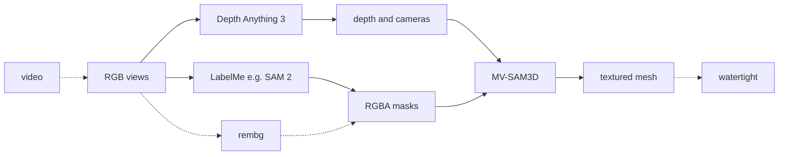
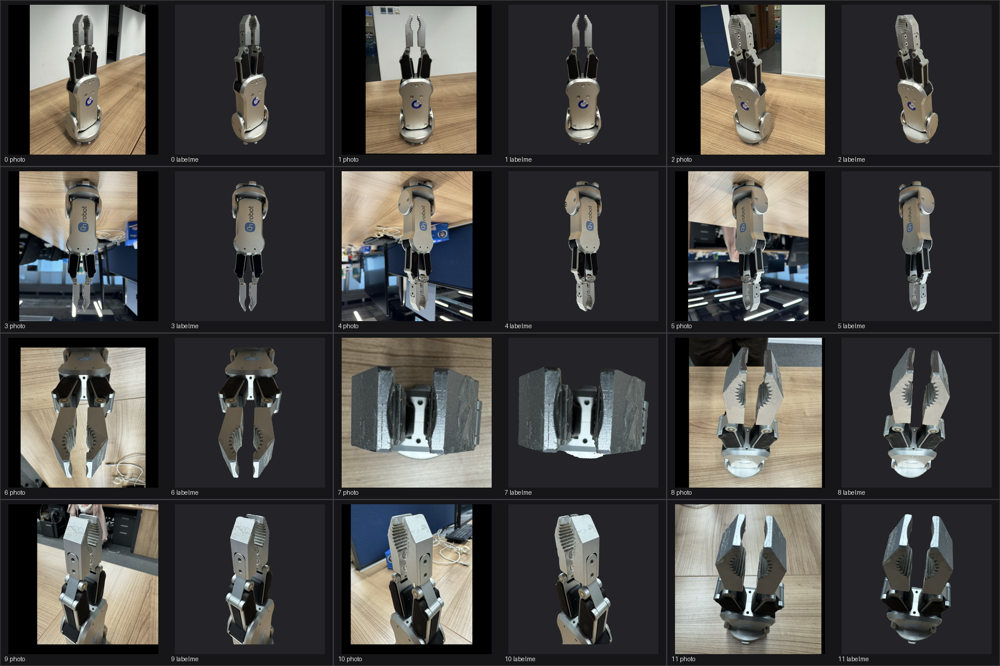
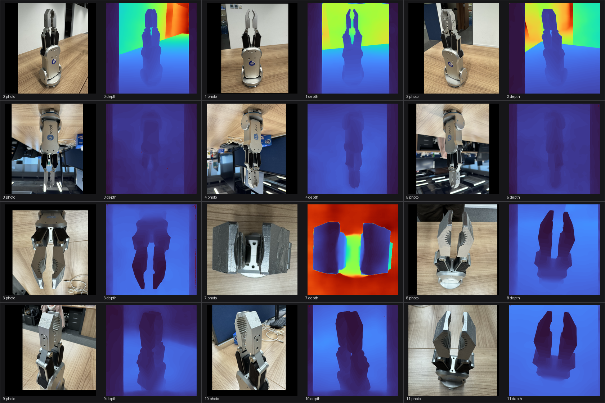
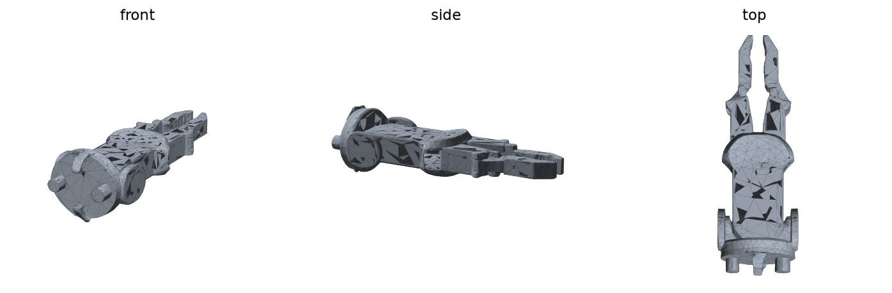
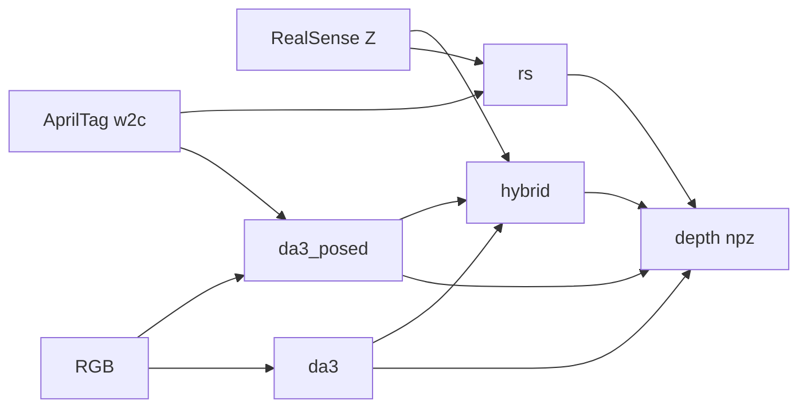

# mv-sam3d-pipeline

Project requirements and development workflow: **[SPEC.md](SPEC.md)**.
Agent instructions: [AGENTS.md](AGENTS.md). Development history: [EXPERIMENTS.md](EXPERIMENTS.md).

This repository reconstructs a textured 3D mesh of a single object from multi-view RGB images or video, as an alternative to modeling the object by hand in CAD.

It is based on [MV-SAM3D](https://github.com/devinli123/MV-SAM3D) and [SAM 3D Objects](https://github.com/facebookresearch/sam-3d-objects). [Depth Anything 3](https://github.com/ByteDance-Seed/Depth-Anything-3) (depth and cameras) and object masks from [LabelMe](https://github.com/labelmeai/labelme) (e.g. [SAM 2](https://github.com/facebookresearch/sam2)) or [rembg](https://github.com/danielgatis/rembg) are optional when those inputs are already available. `--seal` writes a watertight solid.

## Contributing and using Codex

Use [SETUP.md](SETUP.md) for dependencies and tests, and
[SPEC.md](SPEC.md#development-contract) for the contribution workflow. Include
the requirement, focused change, verification and remaining limits in a PR.
Project code is covered by [LICENSE](LICENSE); upstream code, model weights and
reference datasets retain their respective terms and availability requirements.

Start Codex at the repository root. [AGENTS.md](AGENTS.md) points it to the
[portable workflow](SPEC.md#portable-agent-workflow-p01-p09-p12). No custom skill
or previous chat is required. Codex supports
[repository instructions](https://learn.chatgpt.com/docs/agent-configuration/agents-md)
and optional [repository skills](https://learn.chatgpt.com/docs/build-skills).
Keep mandatory project rules in SPEC, rather than depending on an optional skill.

A task can start with:

```text
Read AGENTS.md and SPEC.md. Task: <change and scope>. Evidence: <paths/measurements>.
Requested outputs: <formats>. Acceptance: <dimensions, symmetry, complexity,
motion or behavior, with tolerances>. Identify missing inputs before implementation.
```

For instruments, use [the domain brief](docs/instruments/prompt.md). When changing
accounts, retain the same source revision, accepted inputs and checks; record
model/tool differences under P12. Credentials are not modeling inputs. A new
agent's design is not guaranteed to be identical. Verification is the manual
command in [SETUP.md](SETUP.md#9-tests); no CI workflow or custom skill is required.

## Paper

- [MV-SAM3D](https://arxiv.org/abs/2603.11633) — arXiv:2603.11633
- [SAM 3D](https://arxiv.org/abs/2511.16624) — arXiv:2511.16624
- [Depth Anything 3](https://arxiv.org/abs/2511.10647) — arXiv:2511.10647



`--coacd` sits after `--seal`. Driver scripts live in `src/` (`python src/pipeline.py`). Clones and `env/` (pip freezes + MV-SAM3D patch) stay at the repo root.

**Input**



**Depth**



**Output**



[`examples/gripper/output/mesh.glb`](examples/gripper/output/mesh.glb) is a checked-in result. The CLI writes `output/<family>/<object>/<mesh>/{depth}_{mesh}_mesh.glb`.

## Data Format

Layout rules are defined once in [SPEC.md](SPEC.md#storage-contract-p04).
All objects retain their family: `hestia-rl`, `hkqai-instruments`, `hkqai-trial`,
or `misc`. Current authored models are in `output/<family>/<object>/`;
reconstruction results use its `sam3d/` or `tsdf/` folder. Diagnostics and history
are in `work/<family>/<object>/<method>/`. Inputs remain in
`dataset/<family>/<object>/`, preserving capture groups and states.

Open [the output overview](output/index.html) for direct model links; regenerate
it with `.venv/bin/python -m src.output_layout`. The complete checked-in
`examples/gripper/` stays in place. Migration hashes and paths are recorded in
`output/maintenance/family_layout_20261107.json`; older logs retain historical paths.

`-i` is a processed scene: one RGB per view in `images/`, one RGBA mask per view in `masks/` (or `--masks object` for the gripper example). Same filename, same count. Alpha must have some foreground. The dataset name is that folder’s name (`…/processed` uses the parent name; canonical generated scenes retain the object/run identity). You can also pass an object directory, method directory, or `work/<family>/<object>/<method>/scene/` after staging. `raw/00.png` becomes `images/0.png` after ingest.

## Asset storage and on-demand exports

### Ready-to-share folders

The standing rules are in **[Asset storage and delivery rules](docs/asset-delivery-rules.md)**.
For a directly viewable image of all objects, open
[`output/packages/delivery/preview.jpg`](output/packages/delivery/preview.jpg).
Each object folder also contains its own `preview.jpg` and individual thumbnails.

Open [`output/packages/delivery/index.html`](output/packages/delivery/index.html)
to browse the current handoff thumbnails. Copy or ZIP **one complete object folder**
to share it. Each folder has its own previews, opening instructions and `asset.json`
with units, provenance, file hashes and validation results. It has no runtime
dependencies on the source workspace. These generated files are Git-ignored;
cloning the repo alone does not download the current deliveries or source datasets.

| Collection | Default handoff | Entry file |
| --- | --- | --- |
| QAI instruments (`hkqai-instruments`) | Editable native OpenSCAD and two previews | `openscad/assembly.scad` |
| Hestia, except birds | MuJoCo XML, visual OBJ, separate convex OBJ colliders, textures and three previews | `model.xml` |
| Both Hestia birds | STL and three geometry previews; original scale preserved | `<object>.stl` — **set physical size in the slicer** |
| HKQAI trial | Excluded; existing workflow unchanged | Existing products |

Generate the full collection into a **new or empty** directory:

```bash
.venv/bin/python -m src.delivery --output output/packages/delivery

# Or generate only selected objects into a new handoff folder:
.venv/bin/python -m src.delivery --only sand_container cary60 --output /tmp/selected_assets
```

Selections are data in `src/delivery_profiles.json`: family defaults, explicit
variants, and bird printing exceptions. The four plates use their registered RL
collision variants; both electronic balance variants get independent folders. Add or change
an object there after registering its asset, without editing exporter code.
The canonical name is `electronic_balance`; `scale` remains a compatibility alias
for old commands and the internal recipe/physics key.

MuJoCo exports enumerate the registered collision scene's nodes, preserving every
convex piece and its transform. No object-specific OBJ list or fixed part count is
required. `model.xml` references `meshes/visual/`, `meshes/collision/` and `textures/`
relatively. Appearance is defined in XML, so no unused MTL, GLB, STL or physics
JSON duplicates are shipped. Geometry construction remains in the source recipes;
the delivery step does not infer a new decomposition from the object's name.

Each MuJoCo package is copied to an unrelated temporary directory, compiled and
stepped for 100 steps with finite-state/warning checks; thumbnails render that
relocated model. This is a loading smoke test, not contact/task validation. Existing
estimated physics remains estimated. Plates without recorded mass/inertia remain
**static**, clearly labelled in the gallery; no mass is invented. Headless thumbnails
use MuJoCo EGL by default; set `MUJOCO_GL` before running if another rendering backend
is required. The delivery command needs the dependencies in `env/pipeline-venv.txt`.

Bird STL coordinates are deliberately **not converted to millimetres**: physical
scale is uncalibrated, and the chosen policy is to set dimensions in the slicer.
The meshes are checked for closed, consistently wound positive-volume surfaces;
wall thickness, supports and printing orientation still require slicer review.
OpenSCAD previews are taken from the published build only after checking its source
snapshot and preview hashes. OpenSCAD includes are checked after relocation; this
packaging command does not rerun the CAD build.

Source recipes, accepted geometry, captures and existing outputs are preserved.
The compact handoff is a reproducible delivery, not a replacement authoring source.
Re-export into a new folder after source changes; existing deliveries are snapshots.

### Authoritative sources

Keep the richest authoring source for each object and generate delivery formats
only when requested. There is no universal lossless conversion between CAD,
textured meshes and physics models. Do not replace editable CAD with a GLB or
claim that mesh-to-STEP conversion recovers precise surfaces or design history.

Each current object has an `asset.json` beside its assets. Separate CAD and
simulation registries are used when their units differ. Requested collection
handoffs live under `output/packages/`; previous object exports are preserved in
that object's work folder.

`asset.json` references authoring files in their existing locations rather than
copying them into another source folder. References are relative to the manifest.
Native instrument SCAD remains in `src/instruments/native/`; recipe code, JSON
profiles, texture recipes and required source photographs remain authoring inputs.
The per-delivery `manifest.json` is separate from this source registry. These are
workspace manifests, not self-contained archives: a portable source bundle must
include all referenced files, preserving their relative layout.

- Instruments retain native SCAD, including parameters and shared modules. Their
  normal build already produces a compact CAD/evidence package.
- Recipe-built objects retain code and parameter inputs. Canonical visual GLBs
  embed appearance; authored collision GLBs retain separate convex parts.
- Reconstructed meshes retain their original GLB, calibration metadata and any
  authored physics/collision inputs. Register them with `src.assets.save_manifest`.
- Plate rebuilds produce canonical GLBs and validation, without automatically
  creating OBJ/MTL, STL, MuJoCo folders or ZIPs. Radial-profile colliders can be
  generated on demand from the recorded profile inputs.
- Existing deliveries and validation workspaces are preserved during this
  transition. They may be stale after a rebuild; their presence does not make
  them authoritative. Never delete authoring inputs as redundant exports.

### Codex dependency policy

`codex` identifies an authoring workflow, not a guarantee that every shape was
created from primitives. A corrected reconstruction is a mesh-derived asset;
an OpenSCAD or procedural model can be independently authored. State which one
an asset is. The black spoon reproduces the exact user-preferred mesh and colliders from
`dataset/hestia-rl/spoon_home_black/accepted_geometry/`, with explicit historical
SAM3D-derived provenance. No experimental output folder is required.

Prefer Codex builds that are independent of experimental method directories.
Do not silently read required inputs from `sam3d/`, `tsdf/` or temporary run
folders. If a reconstruction is useful as a permanent source, promote the
specific mesh and its calibration/provenance to a stable source location,
update the builder and manifest, and validate the rebuild before retiring the
experimental folder. Moving a mesh removes the directory dependency; it does
not remove its SAM3D-derived provenance or make it independently authored.
Do not replace accepted geometry solely to avoid that provenance.

Explicitly record dependencies per asset, distinguishing:

- **Rebuild:** source code, parameters, reference files and any imported mesh;
  record exact paths, hashes, origin, purpose and why an imported mesh is needed.
- **Inference:** whether rebuilding needs SAM3D software/weights/GPU, or only a
  previously generated mesh. These are different requirements.
- **Runtime:** files/software needed to load the exported model. A self-contained
  MuJoCo export must not reference an experimental workspace.
- **Remeasurement or historical reproduction:** depth, masks and calibration
  needed to derive measurements again, separately from the normal build.

Keep dependency paths and hashes in `asset.json`; document their roles and
exceptions beside the recipe. Refresh these records when dependencies change.
For spoon iteration, preserve the accepted geometry and limit edits to the
requested region. Compare top/side/reference previews before collision generation
and full validation. The rejected thin-loft attempt, actual errors and faster
iteration sequence are logged in
`output/maintenance/codex_independence_20261105/failures_and_lessons.json`.

Before deleting an old method directory, check manifests, code and symlinks;
preserve required inputs and verify both rebuilding and portable loading.
The presence of a `codex/` folder alone is not a deletion criterion. Registration and export now reject Codex references that resolve into `sam3d/`,
`tsdf/` or `dualbrep/`, including symlinks. Registered file hashes are also checked.
Transitive Python imports and dependency roles still require review; this is not
a general-purpose dependency discovery system.

Current audited status (2026-11-05):

| Assets | SAM3D requirement for current Codex rebuild | Other retained dependency |
| --- | --- | --- |
| C13472, C13534, C16361, Cary 60 | None; native OpenSCAD sources | Original dataset references remain evidence |
| Pink spoon, four Hestia plates, container, electronic balance | None | Original dataset references remain evidence |
| Black spoon | No SAM3D software or method folder; saved accepted meshes are required | Dataset `accepted_geometry/` contains the exact user-preferred visual/colliders and hashed SAM3D-derived provenance |
| Hestia bowl | None; saved recipe is sufficient | Remeasurement and TSDF share `dataset/hestia-rl/hestia_bowl_v1/derived/rgbd/` |
| Both birds | No Codex replacement exists | Active SAM3D visuals/RL assets and shared TSDF input links |

Cleanup and current dependency validation are recorded in
`output/maintenance/codex_independence_20261105/`. SAM3D versions were removed
for all seven objects that had both Codex and SAM3D outputs: the two spoons,
the bowl, and the four instruments. Both birds remain SAM3D assets because
they have no Codex replacement. Earlier audits are historical snapshots.

Inspect an object's registered sources, variants and rebuild command:

```bash
.venv/bin/python -m src.assets inspect output/hestia-rl/sand_container/asset.json
```

Request just the formats needed, using a new or empty output directory:

```bash
.venv/bin/python -m src.assets export output/hestia-rl/sand_container/asset.json \
  --format obj --output output/packages/sand_container_obj_delivery

.venv/bin/python -m src.assets export output/hestia-rl/electronic_balance/asset.json \
  --variant electronic_balance_round --format mujoco \
  --output output/packages/electronic_balance_round_mujoco

.venv/bin/python -m src.assets export output/hkqai-instruments/cary60/asset.json \
  --format scad --output output/packages/cary60_cad_delivery
```

Multiple formats can be explicitly selected, e.g. `--format glb obj stl`.
Source changes invalidate the registry hashes: rebuild and refresh the manifest
before exporting. Export never silently overwrites an existing delivery.
Normal builders refresh the registry; `save_manifest` also supports registration
of existing assets without rebuilding them. The recorded rebuild command is
informational and is never executed by the exporter.

| Requested format | Behavior and requirements |
| --- | --- |
| `glb` | Byte-for-byte copy of the visual master, preserving its full stored appearance/scene data. |
| `obj` | Mesh plus required MTL/PNG; preserves supported base-colour textures/UVs, not all PBR properties or scene semantics. |
| `stl` | Geometry only, in the recorded source units. Native SCAD assemblies are tessellated through OpenSCAD, in mm. |
| `scad` | Copy the registered native SCAD source and dependencies. Mesh/recipe variants without registered SCAD are refused. |
| `step` | Copy a registered solid STEP asset, including HARMYNTA's millimetre CAD registry. Unsupported mesh/CAD conversions are refused. |
| `mujoco` | OBJ/PNG visual plus separate convex OBJ colliders and MJCF. Requires metre units and explicit collision data or the supported radial-profile recipe. Uses recorded physics when available; otherwise exports a static body with placeholder contact settings. |

The generic native-SCAD path supports SCAD and whole-assembly STL only. For a
specific manufactured part, retain `src.instruments stl --model ... --part ...`.
It does not manufacture textured GLBs or articulated MJCF from CAD. The generic
MuJoCo exporter handles rigid bodies; native articulated instruments need their
joint/physics definitions and a dedicated conversion before registration.

Units are chosen per asset and workflow; there is no repository-wide mm-only
rule. Keep source/calibration units explicit and preserve them during renaming or
cleanup. Convert only for a requested destination and check the resulting size
and physical parameters. GLB follows its metre convention. The current generic
MuJoCo exporter accepts metre meshes; that is an exporter requirement, not a
restriction on CAD authoring or raw measurements.

Every export records source and implementation hashes, package versions, units,
frame and offline checks. Keep all delivered mesh/texture dependencies together.
There is no implicit unit conversion: metre GLB produces metre STL, while native
millimetre CAD produces millimetre STL. Uncalibrated meshes cannot be exported for
MuJoCo through this command. Separate collision hulls must stay separate so that
one convex hull does not fill a dish/container cavity. Physics estimates remain
estimates; offline checks are not MuJoCo compilation or simulation tests.

`src/export.py` provides selective visual conversion; `export_pair` remains a
compatibility helper for explicitly requested multi-format deliveries. ZIPs are
optional snapshots of a chosen delivery, not mandatory build outputs. Existing
family-specific export commands remain available for legacy workflows.

Input and output families group related runs:

| Family | Contents |
| --- | --- |
| `hestia-rl/` | `bird_swallow`, `bird_mahjong`, `sand_container`, `hestia_bowl_v1`, `plate_strimmig_pale_grey_green_21cm`, `plate_paradisisk_off_white_20cm`, `plate_maehata_pop_blue_23cm`, `plate_harmynta_white_22cm`, `spoon_home_black`, `spoon_daiso_pink`, `electronic_balance` |
| `hkqai-trial/` | Early coffee, PC, gripper, heater and structure captures/results |
| `hkqai-instruments/` | `cary60`, `c16361`, `c13472`, `c13534` |

Trial inputs preserve their capture groups: for example,
`dataset/hkqai-trial/heater/heater_v5/`. Outputs preserve the existing run/method
layout: `output/hkqai-trial/heater_v5/<method>/`. The original videos live
at `dataset/hkqai-trial/coffee/coffee.mp4`, `dataset/hkqai-trial/pc/pc.mp4`, and
`dataset/hkqai-trial/heater/heater.mp4`. `hkqai-trial` identifies provenance; it is
not a deletion or retention status. Public `examples/gripper/` stays unchanged.

Hestia inputs and outputs use the same object names beneath their family roots.
Plate names come from the IKEA product names or the supplied Maehata label;
spoon names come from the photographed Home Coordy and Daiso labels. Plate
identifiers end in their documented colour and nominal diameter in centimetres:
`plate_strimmig_pale_grey_green_21cm`, `plate_paradisisk_off_white_20cm`,
`plate_maehata_pop_blue_23cm`, and `plate_harmynta_white_22cm`. The suffix is a
product size label, not a requirement on stored coordinate units. Full dimensions,
height and uncertainty remain in the object's metadata. The old
names remain command-line aliases in `src/output_layout.py`; aliases do not
create duplicate directories. `bird1_v1` was explicitly removed from dataset
and output, and is rejected rather than redirected to a different capture.
The removal inventory and rename map are in
`output/maintenance/family_names_20261105/plan.json`.

Original capture filenames, masks, calibration data and compressed plate source
archives are retained. Geometry and textures are not regenerated during a rename.
Historical logs and ZIP snapshots retain their original context and may mention
old names; consult the relocation map. Rebuild current deliveries from the
object's `asset.json` instead of treating a historical ZIP as current.

Start at [the output overview](output/index.html). This is the only generated
navigation page. Link directly to product reviews, assets and directories;
do not create family, method, package or maintenance listing pages.

Historical sources are recovered under their corresponding `dataset/` captures.
Selected experiment results and timing runs live in each run's work folder under
`experiments/` and `benchmarks/`, and cross-object reviews under
`output/comparisons/`. Local migration ledgers live under `output/maintenance/`.
See [the retention policy](docs/maintenance/archive-retirement.md) and
[the local relocation ledger](output/maintenance/archive_retirement/path_map.json).
Historical logs retain recorded paths; the ledger resolves retired locations.

The gripper public example remains `examples/gripper/`. Its 12-view capture set
corresponds to `dataset/hkqai-trial/gripper/gripper_v2/`. The older six-view capture is under
`dataset/hkqai-trial/gripper/captures/legacy_6view/`; keep its poses separate from twelve-view
images. Future example runs write `output/hkqai-trial/gripper/sam3d/`.

The four instruments each have one raw-data root: `dataset/hkqai-instruments/{cary60,c13472,c16361,c13534}/`.
Inside it, `user_captures/<date>[_rgbd_<state>][_annotated]/` groups your dated source
photos/video with the corresponding raw annotations, processed image/mask pairs,
depth and calibration. `online_sources/` holds verified manufacturer/web PDFs
and images. The user confirmed the older `exterior_annotated/` batches are online
downloads. QY's `user_captures/undated_annotated/` contains the user's three processed
image/mask pairs with an unknown capture date. `online_sources/pdf_images/` contains unique
native PDF extractions, mapped by `online_sources/index.json`.

Manufacturer specification drawings and dimension tables for the matching variant
govern geometry wherever available. `evidence.json` records the source PDF pages
and geometry policy. User captures confirm installed details and motion; measured
discrepancies must be recorded and resolved explicitly.

HEICs are replaced with full-resolution PNGs after decoded-pixel, EXIF and ICC
verification. The dataset has no review/preview folder: package review images
are generated in output using the saved material `review_size` and crop coordinates.

`evidence.json` is the authoritative source selection/crop configuration;
`measurements.json` consolidates user and manufacturer readings; `states.json`
records physical-state labels. Source-code evidence files are pointers into this
dataset. Model packages hold generated snapshots and never write evidence back
into the dataset. Capture dates, annotations and calibration are preserved.

Stable run IDs such as `c13472_rgbd_open` remain valid: `run_dataset.py` looks up
the current raw folder in `dataset/hkqai-instruments/catalog.json`. Per-batch `dataset.json` lets
processed-scene input infer a unique run ID instead of using generic names such
as `raw` or `scene`. Mixed/unreviewed batches are rejected: first review their
state/component labels and stage one consistent selection. State indexes are
reference lists, not executable reconstruction recipes. Reconstruction runs are grouped
as `output/hkqai-instruments/<model>/<method>/<run>/` and
`work/hkqai-instruments/<model>/<method>/<run>/`, with `output/hkqai-instruments/<model>/` the current authored delivery
package. Unclassified output objects use the `misc` family; input dataset paths stay unchanged.

A `raw/` folder is either LabelMe (every still has a `.json`) or rembg (no JSON). Build `images/` + masks with the converters in `helpers` (`convert_stills_to_images`, `convert_video_to_frames`, `convert_labelme_to_masks`, `convert_rembg_to_masks`, `crop_views_to_masks`).

The run's work folder holds `depth/`, `scene/`, logs and summary images. Its output
method folder holds `{depth}_{mesh}_mesh.glb` and the corresponding mesh preview.

`src/capture_realsense.py` writes `dataset/captures_*` (SPACE to save). With tags: `convert_realsense_dump` → `tags.convert_apriltag_to_da3_npz` → crop. Without tags: `--rs-dump` builds an unposed RS npz. `src/tsdf.py` fuses metric depth (optional masks). `src/da3_posed.py` runs DA3 with known `w2c` + `K`. Download `mesh.glb`; `mesh.png` is the three-view still.

For current commands, the pipeline flowchart, configurable photo inputs and source reproduction, see [the instrument tools guide](docs/instruments/README.md). The authored CAD/GLB/URDF path can start from source defaults and evidence without an earlier model output.

For dimension-constrained instrument collision models, see [the reusable workflow, C13534 history and next-machine handoff](EXPERIMENTS.md#instrument-modeling-workflow). It combines reconstruction references, calibrated depth, measured dimensions and simple articulated collision parts.

To start another instrument from a short brief, copy [the instrument-model prompt template](docs/instruments/prompt.md), fill its eight fields and point it at your existing photos/video. The [minimal input guide](EXPERIMENTS.md#starting-an-instrument-with-one-prompt) explains which few views are useful and how to leave unknown measurements explicit.

Each instrument has one current **`output/hkqai-instruments/<modelname>/`** package. Their obsolete SAM3D experiments have been removed; native CAD and dataset references are retained.

The current package contains native `openscad/`, parameters, previews, reports
and a portable evidence snapshot. Build diagnostics are kept separately in
`work/hkqai-instruments/<modelname>/codex/`.

Rebuild with `.venv/bin/python -m src.instruments build --model cary60` (or
`c16361`, `c13472`, `c13534`). The builder stages and validates the package before
publishing it. Use `publish` to repackage existing assets, `validate` to check them,
and `share` to create the sharing ZIP.

Builds keep compact outputs by default. Use `build --extras` for additional reviews/states, `build --check-cad --keep-validation` for detailed CAD diagnostics, and `stl --model cary60 --part socket_shell` for an explicit printing export. Successful validation scratch is removed by default; failures are retained. See [the output policy](docs/instruments/README.md#validation-and-outputs).

The sharing ZIP contains regular files and loads independently; the current native CAD package includes its evidence snapshot. Native CAD uses millimetres; simulation assets declare their own units and frames. Contact accuracy and physical dynamics remain unverified. Tau's total height is user-confirmed 253.3 mm; C13472's envelope is approximately 645 × 440 × 385 mm.

Start at [the output overview](output/index.html) or [the four-machine review image](output/comparisons/hkqai-instruments/current_review.png). Historical commands and paths in EXPERIMENTS.md document the development history; they are not current rebuild instructions. The cleanup ledger is `output/maintenance/instruments/instrument_cleanup_20261102/audit.json`.

## Simple product collision models (Codex-authored pipeline)

Container, electronic balance and the regenerated Hestia bowl use selected local reference
images/text -> editable dimensions -> simple symmetric geometry -> visual GLB
and separate convex collision GLB. They reuse the instrument workflow's CPU
renderer; no learned reconstruction is required for these authored primitives.

```bash
.venv/bin/python -m src.measure_product_bowl  # optional RGB-D dimension estimate
.venv/bin/python -m src.products             # build all three products
.venv/bin/python -m src.products --model electronic_balance
.venv/bin/python -m pytest tests/test_products.py -q
```

Edit `src/product_inputs/designs.json`, or pass `--parameters PATH` with the same
schema. Curated image selections and exclusion reasons are in
`src/product_inputs/*_sources.json`; original datasets are preserved. Builds
record source hashes, text hints, parameter provenance and validation reports.
The container follows the selected 325 × 265 × 200 mm variant and includes an
open body only. The electronic balance includes square and round
pan variants. The bowl is approximately Ø120 × 60 mm from local RGB-D evidence;
its dimensions remain provisional (about ±10 mm), and wall thicknesses are estimates.

Current products remain directly under each object's output folder. For sharing, use
the [delivery gallery](output/packages/delivery/index.html): the container, bowl
and both electronic balance variants each have an independent MuJoCo folder with thumbnails.
Regenerate through `src.delivery` as described above. Edit assumed mass and contact
settings in `src/product_inputs/mujoco_physics.json`, rebuild/refresh the asset
registry, then re-export. Mass, inertia and friction are uncalibrated; the electronic balance
is a rigid prop without a weighing sensor.

`src.products_mujoco` and any older `mujoco/` folders belong to the
earlier product-specific exporter. They are not the default handoff and may be
stale. The new deliveries have actual relocated MuJoCo compilation/smoke checks;
older offline reports do not imply runtime validation.

GLBs use metres, X right / Y rear / Z up, bottom at Z=0. Import each named
collision mesh as an individual convex shape: convexifying the entire bowl or
container would fill its opening. Checks cover GLB reload, convexity, winding,
symmetry, visual/collision volume agreement, open cavities and contact surfaces.
Set mass, friction and restitution in the simulator; physical dynamics are not
calibrated. The revised bowl includes a curved heel, raised foot and thin flared
rim. Its 24-sector collision mesh approximates the 48-sector visual mesh within
0.514 mm radially; the container collision mesh preserves the visual boundary.

## Depth

`--method` builds a DA3-style depth npz (`da3` is the default):



- **da3** — pose-free DA3. RGB + masks only.
- **da3_posed** — DA3 with AprilTag cameras (`--pose-npz`).
- **rs** — D415 Z. With tags: shared poses. Without tags: depth + K, identity extrinsics (boards / per-view).
- **hybrid** — full-frame: keep valid RS, fill RS holes with scaled DA3. Posed RS also rejects DA in free space carved by another view.

`hybrid` is built only when you ask for it (or for `--all`). It builds `da3` and `rs` first.

## Mesh

One command names the depth and the mesh. It builds only the depth files that pair needs, skips a depth npz or mesh glb that is already on disk, and writes the summary boards once at the end. `--refresh` rebuilds those files. `--tags` means the RealSense dump has AprilTags. Without it, `rs` or `hybrid` with `tsdf` is refused, and `da3_posed` is refused.

`sam3d` is MV-SAM3D (`sam3d/{depth}_sam3d_mesh.glb`). `tsdf` is Open3D multi-view fusion on the same npz. TSDF needs real extrinsics.

| You want | Command |
|---|---|
| RGB + masks, generated mesh | `--depth da3 --mesh sam3d` |
| RGB + masks, fused mesh | `--depth da3 --mesh tsdf` |
| Tags, generated box | `--depth da3_posed --mesh sam3d --tags` |
| Tags, measured holes | `--depth rs --mesh tsdf --tags` |
| Tags, fill RealSense holes | `--depth hybrid --mesh tsdf --tags` |
| RealSense, no tags, generated mesh | `--depth hybrid --mesh sam3d` |
| Every legal pair | `--all --rs --tags`, `--all --rs`, or `--all` |

## Installation

The commands below assume the driver venv is active (`source .venv/bin/activate`). That venv is converters, tests, and `--seal` / `--coacd` only.

```bash
uv venv .venv
source .venv/bin/activate
uv pip install -r env/pipeline-venv.txt
```

To reconstruct a mesh you also need the GPU stack (DA3, MV-SAM3D, weights) in a separate env, plus the two upstream clones next to `src/` (repo root). That is all in [SETUP.md](SETUP.md). `SAM3D_PYTHON` is that env’s `python`.

## Quick Start

```bash
export SAM3D_PYTHON=/path/to/sam3d-objects/bin/python

python src/pipeline.py -i examples/gripper/processed --masks object
```

Writes the mesh to `output/hkqai-trial/gripper/sam3d/` and staged `scene/` and `depth/` to `work/hkqai-trial/gripper/sam3d/`. New scenes use `masks/` by default; the checked-in gripper example still uses `object/`. If you already have DA3’s npz (depth, `K`, poses), pass `--da3-npz` and DA3 is not run.

```bash
python -m pytest tests
```

## New dataset (`dataset/<name>/`)

After capture + LabelMe (or a processed `images/` + `masks/` scene), name the depth and the mesh. A name alone prints this table and stops.

```bash
export SAM3D_PYTHON=/path/to/sam3d-objects/bin/python

python src/run_dataset.py my_capture --depth rs --mesh tsdf --tags
python src/run_dataset.py my_capture --depth da3 --mesh sam3d
python src/run_dataset.py my_capture --all --rs --tags
```

A second run leaves existing work-folder `depth/*.npz` and output-folder `*_mesh.glb` files in place and redraws the boards. `--refresh` rebuilds them after masks, tags, or views change.

Steps, when one board is wrong: `ingest`, `depth da3|da3_posed|rs|hybrid`, `mesh DEPTH MESH`, `summarize`. `depth rs` is unposed unless you pass `--tags`. These steps do not skip existing files. `summarize` only redraws boards.

| Mode | Depths | Meshes |
|---|---|---|
| `--all` | `da3` | `da3` × sam3d/tsdf |
| `--all --rs` | `rs`, `da3`, `hybrid` | `da3` × sam3d/tsdf, `rs_sam3d`, `hybrid_sam3d` (no rs/hybrid TSDF) |
| `--all --rs --tags` | `rs`, `da3`, `hybrid`, `da3_posed` | all × sam3d/tsdf |

The command writes these boards once, under `work/<family>/<object>/<method>/`:

| File | What it shows |
|---|---|
| `dataset_summary.png` | captured frames |
| `masks_preview.png` | whether the mask took in the table |
| `tags_preview.png` | tag poses, when RealSense was posed |
| `depth_summary.png` | one column per depth npz on disk (`da3`, `da3_posed`, `rs`, `hybrid`) |
| `mesh_summary.png` | 2×3 grid, columns sam3d\|tsdf, rows da3\|rs\|hybrid. The da3 row uses `da3_posed` when that mesh exists. Empty cells are pairs not built yet |
| `output/<family>/<object>/<mesh>/<depth>_<mesh>_mesh.png` | three-view still of that mesh |

Mesh work uses mask-cropped `scene/images/`.

## Seal and CoACD

`--seal` keeps the largest connected component, fills holes, and writes `sealed.stl` (one closed solid).

`--coacd` runs `--seal` first, then convex-decomposes at concavity `t=0.05` into `convex_parts/`. That is for multi-body collision; on the gripper the fingers stay separate. Raise `t` if pieces that should be one body are split; lower `t` if pieces that should be separate are fused.

## Runtime

`src/time_run.py` times `da3` → SAM3D on any processed scene. Default `-i` is the gripper example (12 views, **10 repeats**). Timings use `work/<family>/<object>/sam3d/benchmarks/<scene>_timed/`; unrecognized objects use the `misc` family (`work/hkqai-trial/gripper/sam3d/benchmarks/gripper_timed/` for that example). `--keep-runs` (default) keeps each `run_*/` mesh and npz; `--no-keep-runs` leaves `summary.json` and contact sheets only. `--no-preview` skips `depth_preview.png`.

```bash
python src/time_run.py -i examples/gripper
python src/time_run.py -i path/to/processed --n 3 --no-keep-runs --no-preview
```

Numbers below are the gripper path on NVIDIA RTX PRO 6000 Blackwell. Mean ± sample sd. Repeat runs live in `work/hkqai-trial/gripper/sam3d/benchmarks/gripper_timed/` (not the checked-in example).

**Result.** End to end is **138.4 ± 2.0 s** (~11.5 s/view). SAM3D is most of that (**121.5 ± 2.1 s**). DA3 is **11.1 ± 0.2 s** (~0.93 s/view). Depth is repeatable (RMSE vs run 0 ≈ **0.25 mm**). The mesh is not bitwise-identical — SAM3D is generative (~254k faces ± 1k; chamfer vs run 0 ≈ **8.6 mm ± 0.06 mm**) — but the 10 stills are the same gripper.

| Step | Total (s) | Per view (s) |
|---|---|---|
| DA3 | 11.1 ± 0.2 | 0.93 ± 0.02 |
| depth preview | 4.0 ± 0.2 | — |
| SAM3D | 121.5 ± 2.1 | 10.12 ± 0.18 |
| `mesh.png` | 1.8 ± 0.3 | — |
| **end to end** | **138.4 ± 2.0** | **11.5 ± 0.2** |

## Citation

```bibtex
@article{li2026mv,
  title={MV-SAM3D: Adaptive Multi-View Fusion for Layout-Aware 3D Generation},
  author={Li, Baicheng and Wu, Dong and Li, Jun and Zhou, Shunkai and Zeng, Zecui and Li, Lusong and Zha, Hongbin},
  journal={arXiv preprint arXiv:2603.11633},
  year={2026}
}

@article{sam3dteam2025sam3d3dfyimages,
  title={SAM 3D: 3Dfy Anything in Images},
  author={SAM 3D Team and Xingyu Chen and Fu-Jen Chu and Pierre Gleize and Kevin J Liang and Alexander Sax and Hao Tang and Weiyao Wang and Michelle Guo and Thibaut Hardin and Xiang Li and Aohan Lin and Jiawei Liu and Ziqi Ma and Anushka Sagar and Bowen Song and Xiaodong Wang and Jianing Yang and Bowen Zhang and Piotr Doll\'{a}r and Georgia Gkioxari and Matt Feiszli and Jitendra Malik},
  year={2025},
  eprint={2511.16624},
  archivePrefix={arXiv},
  primaryClass={cs.CV},
  url={https://arxiv.org/abs/2511.16624}
}

@article{depthanything3,
  title={Depth Anything 3: Recovering the visual space from any views},
  author={Haotong Lin and Sili Chen and Jun Hao Liew and Donny Y. Chen and Zhenyu Li and Guang Shi and Jiashi Feng and Bingyi Kang},
  journal={arXiv preprint arXiv:2511.10647},
  year={2025}
}
```

See also [SETUP.md](SETUP.md) (install, `src/` layout, capture) and [EXPERIMENTS.md](EXPERIMENTS.md) (heater jumps, TSDF vs SAM3D).

## License

[MIT](LICENSE)

Plate rebuild commands now live in versioned source:

```bash
.venv/bin/python src/plates/rebuild.py plate_strimmig_pale_grey_green_21cm
.venv/bin/python src/plates/render.py plate_maehata_pop_blue_23cm plate_strimmig_pale_grey_green_21cm plate_paradisisk_off_white_20cm
.venv/bin/python src/plates/review.py
```

Native instrument SCAD remains authoritative. The three simplified plates and
simple products use `src/product_inputs/designs.json`. Plate entries contain
parameters, dimension evidence and radial profile rows in millimetres; their
pattern recipes remain in the tracked dataset JSONs. Plate rebuilds refresh the
visual and compact RL variant from these inputs, without pre-existing outputs.
Generated output metadata is not an authoring source.

HARMYNTA follows the shared layout in [SPEC.md](SPEC.md):

- Inputs: `dataset/hestia-rl/plate_harmynta_white_22cm/` (`images/`, `evidence.json`, and unreplaced originals in `raw/`).
- SolidWorks: **`output/hestia-rl/plate_harmynta_white_22cm/HARMYNTA_220mm.step`**, with `preview.png` and CAD `asset.json` beside it.
- Simulation: `output/hestia-rl/plate_harmynta_white_22cm/simulation/`, with its own metre-scale `asset.json`.
- History, fit comparisons and validation: `work/hestia-rl/plate_harmynta_white_22cm/codex/`.

Editable inputs remain in `src/plates/inputs/`. Build CAD with
`python -m src.plates.solidworks` in the documented pythonocc/SciPy environment;
build the textured mesh, collision variants and preview with
`.venv/bin/python -m src.plates.authored --parameters src/plates/inputs/plate_harmynta_white_22cm.json`.
The standard `src.delivery --only plate_harmynta_white_22cm` selection uses the
simulation registry's configured path. CAD reproduction needs only its tracked
inputs; regenerating the photo-textured preview also needs the accepted images.

The 220 × 40 mm plate has a measured 102.5/87.7 mm foot ring, 5 mm external ring
height, 10 native CAD faces and a 4,864-triangle visual mesh. Curvature is fitted
from photos; physical fit, inner thickness and camera calibration remain provisional.
[The plate record](src/plates/SPEC.md) contains requirements and verification.
Older ZIP deliveries remain historical snapshots.

The corrected spoon models are `spoon_daiso_pink` and `spoon_home_black`.
Their current visuals, separate convex collision GLBs, four-view previews and
section drawings live under `output/hestia-rl/<name>/`.
Rebuild with `.venv/bin/python -m src.spoons.build`; editable geometry is in
`src/spoons/inputs/designs.json`. The pink scoop has a concave inside, convex
underside, recessed inner crown and raised outer crown. Its revised shell uses
nominal 3 mm material thickness across the sloping walls and a rounded lip;
39 sampled steep-wall measurements on the mesh are 3.04–3.50 mm. These are
authored estimates, not measured physical thickness. It models the captured
short-socket head (approximately 100 × 136 × 41 mm), not the complete 26 cm
handled product on the [Daiso reference page](https://jp.daisonet.com/products/4550480456553).
The pink socket uses a tapered loft buried into the rear bowl wall, with
local smoothing across the joint. The 335 mm black ladle has been restored to the previous user-preferred
visual and colliders, preserving its original thickness and straight transverse
support bar. The attempted full loft was rejected as too thin; the remaining
handle-width irregularity is not claimed fixed.
All dimensions remain provisional. Original photos remain in the dataset;
obsolete spoon SAM3D versions have been removed. Old names remain accepted aliases.

The original reconstruction route is photos → object masks and DA3 depth/cameras
→ MV-SAM3D → metric alignment. Current spoon revisions run on CPU in
`src/spoons/build.py`: pink is authored from the photo-informed JSON recipe using
NumPy, Trimesh, Shapely and Manifold; black is reproduced by `src/spoons/black.py`
from the exact accepted visual/collider sources in its dataset. Black remains
mesh-derived and its provenance is explicit. Neither spoon reads a SAM3D method
directory or runs learned inference.
The builder writes the coloured visual GLB, separate convex collision GLB,
physics estimates, previews, geometric checks and hashed `asset.json` registry.
Then `src.assets export --format mujoco` produces relative OBJ/MTL/PNG assets
and MJCF in a new delivery directory. `src.mujoco_check` compiles that model,
simulates it and tests a ball inside the cavity before the requested ZIP is
refreshed. Keep the convex pieces separate so MuJoCo preserves the bowl opening.

Rebuild both with `.venv/bin/python -m src.spoons.build`, then refresh and test
MuJoCo deliveries with `.venv/bin/python -m src.spoons.deliver`. Both builds have
been verified with their SAM3D directories absent. The bowl's measurement
inputs now live in `dataset/hestia-rl/hestia_bowl_v1/derived/rgbd/`; its TSDF
links point there. Only the birds retain SAM3D assets in the Hestia family.

## MuJoCo RL collision versions

Hestia assets use separate visual (contact disabled) and convex collision meshes.
The corrected spoons have 103 and 75 hulls and tested thin-wall contact settings.
Pink uses 64 bowl cells, 32 curved socket cells and 7 crown cells; its extra
socket segments follow the revised joint. Black retains the previously validated bowl cells, short handle segments
and separate support bar. These are deliberately coarser than the
visual meshes.
For current spoon handoffs, open `model.xml` in the relevant folder under
`output/packages/delivery/hestia-rl/`. Earlier validation scenes live at
`work/hestia-rl/<spoon>/codex/exports/mujoco_rl/mujoco/collision/scene.xml`; the retained historical
bundle is `output/packages/spoons_mujoco_rl.zip`. MuJoCo 3.17 compiled those spoon models,
ran 1,000 simulation steps and passed 1,500-step ball-in-cavity tests without a
floor beneath the bowls. Mass/friction and dimensional estimates are not calibrated.

`.venv/bin/python -m src.rl_collision --root output/hestia-rl` adds explicit
`_rl` collision alternatives for plates and birds while retaining original visuals
and detailed compounds. Other suitable authored colliders are reused. The inventory
and runtime results are in `output/comparisons/hestia_rl_collision/`.
Current collection exports use `output/packages/`; previous per-object exports
remain in the corresponding work folder.
Bird collider coordinates remain uncalibrated: specify physical dimensions before
using them in a metre-scale scene. MuJoCo exports deliberately refuse uncalibrated
bird manifests. Model compile/smoke tests are not RL task validation.
