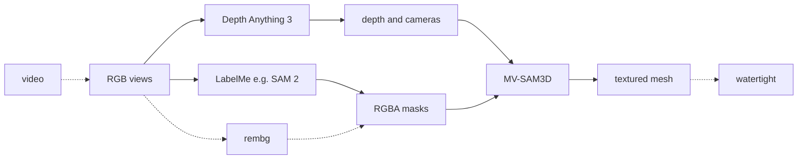
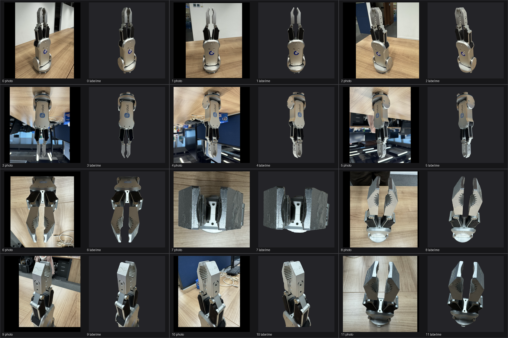
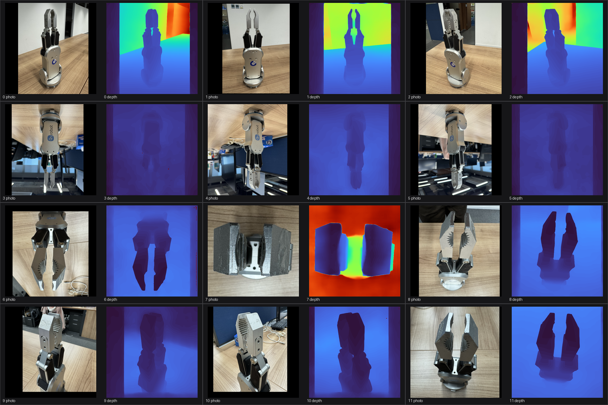
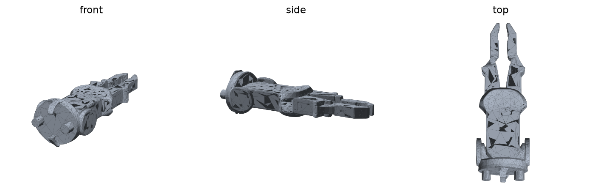
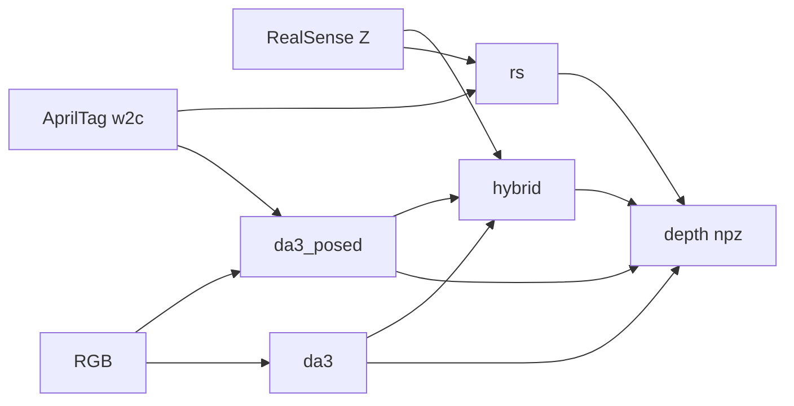

# mv-sam3d-pipeline

This repository reconstructs a textured 3D mesh of a single object from multi-view RGB images or video, as an alternative to modeling the object by hand in CAD.

It is based on [MV-SAM3D](https://github.com/devinli123/MV-SAM3D) and [SAM 3D Objects](https://github.com/facebookresearch/sam-3d-objects). [Depth Anything 3](https://github.com/ByteDance-Seed/Depth-Anything-3) (depth and cameras) and object masks from [LabelMe](https://github.com/labelmeai/labelme) (e.g. [SAM 2](https://github.com/facebookresearch/sam2)) or [rembg](https://github.com/danielgatis/rembg) are optional when those inputs are already available. `--seal` writes a watertight solid.

## Paper

- [MV-SAM3D](https://arxiv.org/abs/2603.11633) — arXiv:2603.11633
- [SAM 3D](https://arxiv.org/abs/2511.16624) — arXiv:2511.16624
- [Depth Anything 3](https://arxiv.org/abs/2511.10647) — arXiv:2511.10647



`--coacd` sits after `--seal`. Driver scripts live in `src/` (`python src/pipeline.py`). Clones, `env/`, and `patches/` stay at the repo root.

**Input**



**Depth**



**Output**



[`examples/gripper/output/mesh.glb`](examples/gripper/output/mesh.glb) is a checked-in result. The CLI writes `output/<name>/meshes/{depth}_{mesh}_mesh.glb`.

## Data Format

```text
dataset/<name>/              # raw capture only (read-only)
examples/gripper/
  raw/                       # 00.png + 00.json, …
  processed/
    images/0.png …           # RGB (stems 0, 1, 2, …)
    object/0.png …           # RGBA masks (example keeps this name)
  output/                    # checked-in stills + mesh.glb
output/<name>/
  scene/                     # images/ + masks/ (staged)
  depth/                     # *.npz + *depthmap* / *valid* / source_map
  meshes/                    # flat {depth}_{mesh}_mesh.glb (+ _mesh.png)
  depth_summary.png          # summaries + masks_preview at dataset root
  mesh_summary.png
```

`-i` is a processed scene: one RGB per view in `images/`, one RGBA mask per view in `masks/` (or `--masks object` for the gripper example). Same filename, same count. Alpha must have some foreground. The dataset name is that folder’s name (`…/processed` or `…/scene` uses the parent name). You can also pass `output/<name>/` after staging (it looks under `scene/`). `raw/00.png` becomes `images/0.png` after ingest.

A `raw/` folder is either LabelMe (every still has a `.json`) or rembg (no JSON). Build `images/` + masks with the converters in `helpers` (`convert_stills_to_images`, `convert_video_to_frames`, `convert_labelme_to_masks`, `convert_rembg_to_masks`, `crop_views_to_masks`).

`depth/` holds `{source}.npz` plus full-frame `*_depthmap.png` / `*_valid.png` / `hybrid_source_map.png`. Summaries (`depth_summary.png`, `mesh_summary.png`) stay on `output/<name>/`. Meshes are flat under `meshes/` as `{slug}_mesh.glb` + `{slug}_mesh.png` (e.g. `da3_sam3d_mesh.glb`).

`src/capture_realsense.py` writes `dataset/captures_*` (SPACE to save). With tags: `convert_realsense_dump` → `tags.convert_apriltag_to_da3_npz` → crop. Without tags: `--rs-dump` builds an unposed RS npz. `src/tsdf.py` fuses metric depth (optional masks). `src/da3_posed.py` runs DA3 with known `w2c` + `K`. Download `mesh.glb`; `mesh.png` is the three-view still.

## Depth

`--method` builds a DA3-style depth npz (`da3` is the default):



- **da3** — pose-free DA3. RGB + masks only.
- **da3_posed** — DA3 with AprilTag cameras (`--pose-npz`).
- **rs** — D415 Z. With tags: shared poses. Without tags: depth + K, identity extrinsics (boards / per-view).
- **hybrid** — full-frame: keep valid RS, fill RS holes with scaled DA3. Posed RS also rejects DA in free space carved by another view.

When both DA3 and RS npzs exist, the pipeline always writes `depth/hybrid.npz` as a side product.

## Mesh

`--mesh sam3d` (default) is MV-SAM3D generation (`meshes/{depth}_sam3d_mesh.glb`, including `rs_sam3d` when `--method rs`). `--mesh tsdf` is Open3D multi-view TSDF on the same npz — it **requires real extrinsics**. Unposed RS / hybrid (no AprilTags, identity `w2c`) is rejected; use SAM3D or `da3` / `da3_posed` TSDF instead.

| You have | Run |
|---|---|
| RGB + masks only | `--method da3 --mesh sam3d` (or `--mesh tsdf` — DA3 poses) |
| RS dump, no tags | `--rs-dump …` + `--method da3` / `hybrid` + `--mesh sam3d` (not TSDF on RS/hybrid) |
| Tags, closed box | `--method da3_posed --mesh sam3d` |
| Tags + RS, measured holes | `--method rs --mesh tsdf` |
| Tags + RS, fill RS holes | `--method hybrid --mesh tsdf` |

## Installation

The commands below assume the driver venv is active (`source .venv/bin/activate`). That venv is converters, tests, and `--seal` / `--coacd` only.

```bash
uv venv .venv
source .venv/bin/activate
uv pip install -r env/pipeline-venv.txt
```

To reconstruct a mesh you also need the GPU stack (DA3, MV-SAM3D, weights) in a separate env, plus the two upstream clones next to `src/` (repo root). That is all in [SETUP.md](SETUP.md). `SAM3D_PYTHON` is that env’s `python`.

## Quick Start

```bash
export SAM3D_PYTHON=/path/to/sam3d-objects/bin/python

python src/pipeline.py -i examples/gripper/processed --masks object
```

Writes `output/gripper/` (`scene/images/`, `scene/object/` or `scene/masks/`, `depth/da3.npz`, `meshes/da3_sam3d_mesh.glb`). New scenes use `masks/` by default; the checked-in gripper example still uses `object/`. If you already have DA3’s npz (depth, `K`, poses), pass `--da3-npz` and DA3 is not run.

```bash
python -m pytest tests
```

## New dataset (`dataset/<name>/`)

After capture + LabelMe (or a processed `images/`+`masks/` scene), run one command. It builds every **valid** depth × mesh for the mode and refreshes summaries (including after each mesh).

```bash
export SAM3D_PYTHON=/path/to/sam3d-objects/bin/python
NAME=my_capture
PY=.venv/bin/python

$PY src/run_dataset.py $NAME all --rs --tags       # RealSense + AprilTags
$PY src/run_dataset.py $NAME all --rs --unposed    # RealSense, no tags
$PY src/run_dataset.py $NAME all --no-rs           # RGB+masks only → da3
```

Optional filters: `--depth da3,hybrid` `--mesh sam3d,tsdf`. Steps also work one at a time: `ingest`, `rs`, `da3`, `da3_posed`, `hybrid`, `mesh DEPTH MESH`, `summarize`.

| Mode | Depths | Meshes |
|---|---|---|
| `--no-rs` | `da3` | `da3` × sam3d/tsdf |
| `--rs --unposed` | `rs`, `da3`, `hybrid` | `da3` × sam3d/tsdf, `rs_sam3d`, `hybrid_sam3d` (no rs/hybrid TSDF) |
| `--rs --tags` | `rs`, `da3`, `hybrid`, `da3_posed` | all × sam3d/tsdf |

Outputs under `output/<name>/`: `dataset_summary.png` (full-frame dump RGBs), `masks_preview.png`, `tags_preview.png` (full-frame overlay + axes when `--tags`), `depth_summary.png`, `mesh_summary.png` (2×3: columns sam3d|tsdf, rows da3|rs|hybrid; da3 row prefers `da3_posed` when tags). Mesh work uses mask-cropped `scene/images/`.

## Seal and CoACD

`--seal` keeps the largest connected component, fills holes, and writes `sealed.stl` (one closed solid).

`--coacd` runs `--seal` first, then convex-decomposes at concavity `t=0.05` into `convex_parts/`. That is for multi-body collision; on the gripper the fingers stay separate. Raise `t` if pieces that should be one body are split; lower `t` if pieces that should be separate are fused.

## Runtime

`src/time_run.py` times `da3` → SAM3D on any processed scene. Default `-i` is the gripper example (12 views, **10 repeats**). Writes `archive/<scene>_timed/` (`archive/gripper_timed/` for that example). `--keep-runs` (default) keeps each `run_*/` mesh and npz; `--no-keep-runs` leaves `summary.json` and contact sheets only. `--no-preview` skips `depth_preview.png`.

```bash
python src/time_run.py -i examples/gripper
python src/time_run.py -i path/to/processed --n 3 --no-keep-runs --no-preview
```

Numbers below are the gripper path on NVIDIA RTX PRO 6000 Blackwell. Mean ± sample sd. Repeat runs live in `archive/gripper_timed/` (not the checked-in example).

**Result.** End to end is **138.4 ± 2.0 s** (~11.5 s/view). SAM3D is most of that (**121.5 ± 2.1 s**). DA3 is **11.1 ± 0.2 s** (~0.93 s/view). Depth is repeatable (RMSE vs run 0 ≈ **0.25 mm**). The mesh is not bitwise-identical — SAM3D is generative (~254k faces ± 1k; chamfer vs run 0 ≈ **8.6 mm ± 0.06 mm**) — but the 10 stills are the same gripper.

| Step | Total (s) | Per view (s) |
|---|---|---|
| DA3 | 11.1 ± 0.2 | 0.93 ± 0.02 |
| depth preview | 4.0 ± 0.2 | — |
| SAM3D | 121.5 ± 2.1 | 10.12 ± 0.18 |
| `mesh.png` | 1.8 ± 0.3 | — |
| **end to end** | **138.4 ± 2.0** | **11.5 ± 0.2** |

## Citation

```bibtex
@article{li2026mv,
  title={MV-SAM3D: Adaptive Multi-View Fusion for Layout-Aware 3D Generation},
  author={Li, Baicheng and Wu, Dong and Li, Jun and Zhou, Shunkai and Zeng, Zecui and Li, Lusong and Zha, Hongbin},
  journal={arXiv preprint arXiv:2603.11633},
  year={2026}
}

@article{sam3dteam2025sam3d3dfyimages,
  title={SAM 3D: 3Dfy Anything in Images},
  author={SAM 3D Team and Xingyu Chen and Fu-Jen Chu and Pierre Gleize and Kevin J Liang and Alexander Sax and Hao Tang and Weiyao Wang and Michelle Guo and Thibaut Hardin and Xiang Li and Aohan Lin and Jiawei Liu and Ziqi Ma and Anushka Sagar and Bowen Song and Xiaodong Wang and Jianing Yang and Bowen Zhang and Piotr Doll\'{a}r and Georgia Gkioxari and Matt Feiszli and Jitendra Malik},
  year={2025},
  eprint={2511.16624},
  archivePrefix={arXiv},
  primaryClass={cs.CV},
  url={https://arxiv.org/abs/2511.16624}
}

@article{depthanything3,
  title={Depth Anything 3: Recovering the visual space from any views},
  author={Haotong Lin and Sili Chen and Jun Hao Liew and Donny Y. Chen and Zhenyu Li and Guang Shi and Jiashi Feng and Bingyi Kang},
  journal={arXiv preprint arXiv:2511.10647},
  year={2025}
}
```

See also [SETUP.md](SETUP.md) (install, `src/` layout, capture) and [EXPERIMENTS.md](EXPERIMENTS.md) (heater jumps, TSDF vs SAM3D).

## License

[MIT](LICENSE)