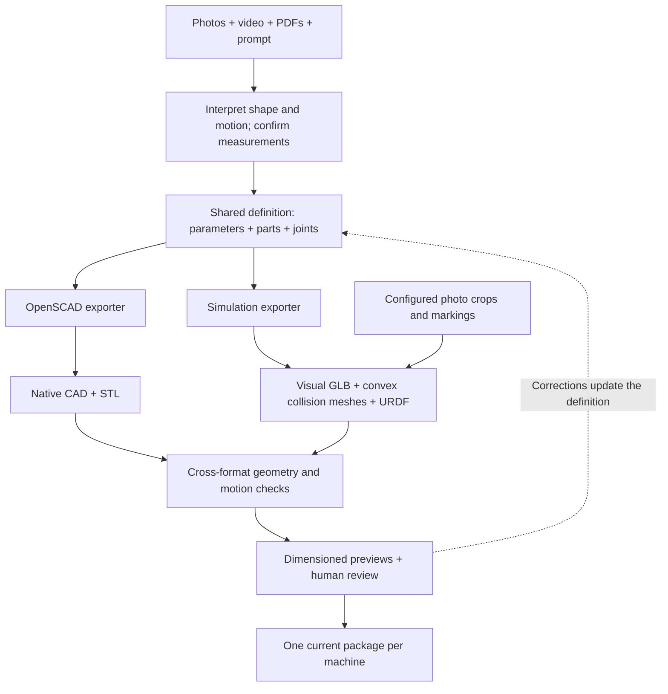

# Instrument modeling

Use one command interface from the repository root:

```bash
.venv/bin/python -m src.instruments build --model cary60
.venv/bin/python -m src.instruments publish --model cary60
.venv/bin/python -m src.instruments validate
.venv/bin/python -m src.instruments share
```

`build` regenerates geometry, visual textures, URDF, dimension views and the current package. Omit `--model` to build all four instruments. `publish` refreshes packaging without regenerating geometry. `validate` checks a standalone copy for hashes, material paths and PyBullet loading; no ZIP is required. `share` creates `output/instruments/instruments_share.zip`; rerun it after model changes to refresh that snapshot.

Current models live in `output/instruments/<machine>/model/`. If no current model exists, the builder initializes from the source defaults. Original captures and evidence live in `dataset/instruments/<machine>/`. Builds use a temporary `.build_work/` folder and replace the current package only after export validation. A failed build leaves that work folder available for diagnosis. Dated build directories and release backups are not created.

Start a new machine with [prompt.txt](prompt.txt). Record measurements with units, endpoints, source and uncertainty. Use previous captures as well as the newest ones. Never fuse different moving states as one rigid scene or present unmeasured details as verified contact geometry.

For sharing, choose the archive by purpose:

- `share` → `output/instruments/instruments_share.zip`: current GLB, URDF, OpenSCAD, previews and portable evidence for viewing/simulation.
- `share --project` → `output/instruments/instruments_project.zip`: Python source, recipes, current parameter snapshots, input manifests, guide/prompt, tests, dependency versions and all instrument datasets for rebuilding. Includes original photos/videos and manufacturer references, but no environment or generated meshes. Extract and follow its root `README.md`.

The project archive is a colleague handoff with source and data; it is larger than
a code-only public release. Model archives exclude the project ZIP, so repeated
sharing does not nest the archives inside one another.

## Compact outputs and optional diagnostics

Ordinary builds retain textured closed/open GLBs, the assembly PNG, one combined
five-view dimension PNG, editable SCAD, URDF and every required collision/visual
asset, parameters, provenance, limitations and numerical check summaries.
Per-part URDF meshes are intentional: keep convex collision pieces separate.
The build may use extra intermediate exports for checks; compact publication
omits these reproducible artifacts. ZIP files are made only by `share`.

```bash
# Optional review images, motion GIF, collision GLBs and all supported poses
.venv/bin/python -m src.instruments build --model cary60 --extras
# Native CAD checks plus retained edited-parameter models and engine logs
.venv/bin/python -m src.instruments build --model cary60 --check-cad --keep-validation
# Retain the standalone loading-check package
.venv/bin/python -m src.instruments validate --model cary60 --keep-validation
# Explicit printing export: one semantic CAD part; STL coordinates are millimetres
.venv/bin/python -m src.instruments stl --model cary60 --part socket_left
```

`--keep-validation` retains only the checks invoked; it does not imply `--check-cad`.
Successful scratch work is removed by default. Requested diagnostics replace
`<machine>/validation/latest/`; failed checks retain their files and traceback in
`<machine>/validation/failures/`. A failed build also retains `.build_work`;
a subsequent attempt moves it into failures rather than mixing it with fresh work.
Diagnostics and historical experiments are excluded from model sharing ZIPs. STL exports live in `<machine>/printing/`
and include a report; watertightness is not proof of fit or printer suitability.
Use the recipe's semantic part name (composite collision pieces may have suffixes).

`publish --extras` can only retain extras already present; use `build --extras`
to regenerate missing ones. `publish --keep-validation` preserves existing
reviews while converting a package to the compact layout. This is not a new check.
Original photos/videos and measurement records are never pruned by output policy.

The current refactor centralizes storage and diagnostic handling. Machine recipes
and the existing simple/QY exporters remain in `src/instruments`; a unified
reconstruction/generation/authoring facade is not implemented by this cleanup.

## Where things belong

```text
dataset/instruments/<machine>/
  captures/<date>_<source>_<batch>/raw/   original photos/video/depth/annotations
  references/pdf/                       manufacturer documents and drawings
  references/model_evidence/            selected/decoded working references
  references/recovered_sources/         preserved sources from earlier experiments
  measurements.json                     readings, endpoints and uncertainty
  states/                               which images show which physical state

output/instruments/
  index.html, instruments_review.png    four-machine overview
  instruments_share.zip                 portable snapshot of all four
  <machine>/model/
    index.html, README.txt               entry points
    parameters.json                     authoritative editable dimensions
    manifest.json                        asset hashes (ZIPs are on demand)
    meshes/                             visual_closed.glb, visual_open.glb
    urdf/                               robot.urdf, separate parts, loader/settings
    openscad/                           assembly, parameter include, helpers
    previews/                           assembly.png (closed/open review)
    dimensions/                         overview.png; numerical measurements if available
    reports/                            validation, parts, provenance, limitations
    textures/                           photo patches, markings and provenance
    evidence/                           link to dataset; ZIP embeds regular copies

src/instruments/                        reusable implementation and machine recipes
  storage/                              shared output policy and validation lifecycle
  inputs/<machine>/                     bootstrap parameters and evidence
  qy/                                   QY articulation/export helpers
  scad/common.scad                      reusable native CAD primitives
tests/instruments/                      regression tests
docs/instruments/                       this guide and the copyable prompt
```

One current package per machine. Earlier inference comparisons, where retained, live
in a separate experiments/ folder and are excluded from model sharing ZIPs. Keep source evidence in the dataset and reusable code
in `src/instruments`; temporary build files stay in `.build_work/` and disappear after
successful publication. `layout.py` applies the same layout every time. It removes
identical aliases, groups review files, and drops previous-iteration comparison PNGs.
Unknown files are retained; a differing mesh alias stops publication for review.

Use `meshes/visual_<state>.glb` for appearance. `build --extras` also retains
`meshes/collision_<state>.glb` for review. URDF always includes its collision pieces. Old `closed.glb`, `*_controls_*.glb` and model-named URDF
aliases are retired; `urdf/robot.urdf` is the single loading entry point.
QY derived assembly metadata and confirmed-reading snapshots live in `reports/`.
Old paths in historical provenance record their original build inputs; the package
manifest includes the report/preview relocation map.

The working pipeline is: evidence + prompt → reviewed shape/motion interpretation
→ one parametric recipe → deterministic exports → checks and user corrections.
The first interpretation stage requires judgment; it is not automatic image-to-CAD.

## Pipeline and consistency contract



The branches are separate export backends, not independent attempts to infer the
machine. Both consume the same named dimensions, part relationships and joints.
OpenSCAD is not an intermediate STL that we convert into an articulated URDF.

| Check | Assurance | Limit |
| --- | --- | --- |
| Part bounds and volumes | Native CAD and convex parts follow the same dimensions | Curves have explicit tessellation tolerances; this is not pointwise surface equality |
| GLB/URDF transforms | Joint origins, axes and exported poses agree | Dynamics and latch behavior are not physically verified |
| Edited-parameter experiments | Changes reach both exporters | Tested edits do not cover every possible parameter combination |
| Sampled simulator sweeps | Detect modeled penetration along tested motion | No continuous-motion or real-world contact guarantee |
| Portable package validation | Meshes, materials, images and links resolve after extraction | It does not measure the real instrument |

Fixed parameters, recipes, evidence and software versions produce repeatable model
geometry. New photos can change the interpretation; similar input photos alone do
not guarantee identical geometry. Cross-version serialized bytes, ZIP timestamps
and rendering are not promised to be identical. Use geometric checks for comparison.

## Reuse with more photos

Each machine has two editable source input files under `src/instruments/inputs/<machine>/`:

- `design_defaults.json`: initial numeric dimensions, measurement evidence and descriptive metadata. Used when no current model exists. For an existing model, its `parameters.json/design_parameters` takes precedence.
- `evidence.json`: geometry-source paths, material crop rectangles and photographed marking placements. Paths are relative to the data workspace; `review_image` is relative to the machine's `references/model_evidence/` folder. Crop coordinates refer to that exact decoded image; marking corners refer to its configured resized `review_size`.

The current [Tau manifest](../../src/instruments/inputs/c16361/evidence.json) is a complete example. A material record looks like:

```json
{
  "review_image": "new_front.jpg",
  "original": "dataset/instruments/c16361/captures/2026-11-03_photo_01/raw/new_front.jpg",
  "crop_pixels": [40, 30, 200, 160]
}
```

1. Preserve new originals under the dated capture folder. Decode selected HEIC/video frames into `references/model_evidence/` with orientation and frame timestamps recorded; the builder consumes reviewed images, not raw video inference.
2. Use [prompt.txt](prompt.txt) to describe the task, state, corrections and measurements. Update `geometry_sources` for evidence actually used. Adding a file to the folder alone does not make it a geometry constraint.
3. Review measurements and topology. Edit shared parameters for sizes, or the machine recipe for new parts/joints. Update material crops/marking corners in `evidence.json` when using new images; do not reuse old pixel coordinates blindly.
4. Run `build --model MODEL --check-cad`, review dimension/interior PNGs, then run `validate` and `share`. Arbitrary generated SCAD edits do not propagate; use the documented numeric import or change the shared recipe.

Machine-specific capture selection and photo placement are now data, not separate
Python scripts. CAD, convex primitives, texturing, packaging and checks are reused.
The initial four recipes remain machine-specific. For a fifth instrument, add its
recipe/defaults/evidence, register its ID in `paths.py`, and extend the necessary
view, decal-anchor and validation cases. The simple-cover and QY articulated paths
are not yet a universal plugin interface. Do not claim arbitrary photo-to-CAD.

## Source release and reproduction

The reusable code is repository-native Python under the root MIT license. A source
release needs `src/instruments/`, its `inputs/` and `scad/` assets, this guide/prompt,
the instrument tests and the dependency file. The existing routing tests also use
`src/helpers.py`, so running the full test set assumes the source repository.
Original lab captures and manufacturer documents stay outside the code release;
users supply the evidence referenced by their manifests. The model sharing ZIP is
a viewing/simulation package, not a source-code distribution.

A separate environment can use the observed direct dependency versions:

```bash
python3.11 -m venv .venv-instruments
.venv-instruments/bin/python -m pip install -r env/instruments-requirements.txt
.venv-instruments/bin/python -m pytest tests/instruments -q
.venv-instruments/bin/python -m src.instruments build --model c16361 --check-cad
```

OpenSCAD must be on PATH or configured with `OPENSCAD`. Review rendering currently
uses Linux DejaVu fonts at `/usr/share/fonts/truetype/dejavu/`; this is the tested
platform. The dependency file records direct versions, not a full platform lock.
A fresh internet installation has not been tested in this workspace. Standard
PyBullet installation is preferred; `INSTRUMENT_PYBULLET_PATH` supports an existing
external installation (the local temporary fallback is not a release requirement).
No DA3, SAM3D weights or GPU inference are needed for these authored models.

Set `INSTRUMENT_WORKSPACE=/absolute/workspace` to keep `dataset/` and `output/`
outside the source checkout. Source defaults, evidence manifests and recipes stay
with the code. A first build uses checked-in defaults and supplied evidence;
no prior mesh/model output is required. Subsequent builds preserve current editable
parameters. The four initial builds were tested in an empty output workspace using
the supplied evidence, including portable URDF loading. All exported geometry,
poses and texture pixels were checked against the accepted models; this does not
constitute testing on arbitrary unseen photos.

## Reusable implementation

- `src/instruments/__main__.py`: CLI only; imports the selected operation lazily.
- `builder.py`, `construction.py`, `geometry.py`, `openings.py`: current geometry assembly, convex primitives, motion, export and geometric checks.
- `design.py`, `shared_geometry.py`, and `<machine>.py`: shared parameter ownership, part/joint recipes, native SCAD and convex-mesh backends, and restricted numeric parameter import.
- `render.py`, `textures.py`, `decals.py`: mesh-derived previews and photo-based visual assets.
- `qy/`: articulated transforms (`kinematics.py`), URDF export, dimension reporting and portable simulator loader. Geometry lives in `c13534.py`; no executable imports from archived experiments.
- `storage/`: compact output policy, combined dimension sheet, optional diagnostic retention and failure preservation.
- `publish.py`, `layout.py`, `validation.py`, `sharing.py`: package lifecycle and standalone verification.
- `printing.py`: explicit single-part native STL export in millimetres with solid checks.
- `inputs/`: bootstrap design defaults with evidence and confirmed QY measurements; current editable values live in each package's `parameters.json/design_parameters`.
- `physics.py`: PyBullet dependency loading; supports `INSTRUMENT_PYBULLET_PATH`. The existing local temporary installation remains a fallback.
- `tests/instruments/`: parameter import, geometry relationships, articulation and CLI regression tests.

Historical experiment commands in EXPERIMENTS.md are a chronology, not current entry points. Raw sources and accepted geometry should not change during tooling cleanup. Photographic textures and estimated contact surfaces retain the limitations recorded in each package.

## Native parametric OpenSCAD

All four instruments use one shared part/joint recipe for native OpenSCAD and simulation meshes. The recipes are `cary60.py`, `c16361.py`, `c13472.py` and `c13534.py`; `shared_geometry.py` supplies both backends. `scad/common.scad` is the only hand-written SCAD library. Per-machine assembly files are generated, not separate maintained geometry recipes.

```bash
.venv/bin/python -m src.instruments cad --model cary60 --check
.venv/bin/python -m src.instruments cad --check  # all four
```

Checks require OpenSCAD on PATH, or `OPENSCAD=/path/to/openscad`. Each machine is staged before publication. The repository does not install OpenSCAD automatically. For source export without an engine check, omit `--check`. Standard builds export CAD source; add `--check-cad` to run the engine before publishing. Changed CAD source/parameter inputs invalidate previous checks and renders; unchanged inputs retain them during packaging cleanup.

Open `output/instruments/<machine>/model/openscad/assembly.scad`. The other SCAD files are dependencies, not alternative model versions:

- `assembly.scad`: entry point; choose `pose` and `part` here.
- `parameters_native.scad`: included dimensions, in mm/degrees (fractions are dimensionless).
- `common.scad`: reusable geometry helpers, required by all four machines.

The obsolete `faceted_reference.scad` exports were removed from all current packages. `parameters_native.json` records parameter evidence; STL files and review PNGs are generated results.

## Shared-definition workflow for all four

Authoritative editable values are `output/instruments/<machine>/model/parameters.json` → `design_parameters`. Each machine recipe defines parts, datum relationships and joints once. Native SCAD uses primitives, Boolean openings and profile extrusion; simulation retains separate convex pieces around openings. Both use the same parameters and joint hierarchy. Curves can have different tessellation densities.

Either edit `design_parameters` and run a normal build, or edit the numeric assignments in `openscad/parameters_native.scad` and import them:

```bash
.venv/bin/python -m src.instruments build --model c16361 --from-cad-parameters --check-cad
.venv/bin/python -m src.instruments share
```

Replace `c16361` with any machine ID, or omit `--model` for all four. The first command imports parameter edits, validates geometry, and regenerates CAD, textured visual GLBs, convex collision meshes, URDF, dimension PNGs and previews. `--check-cad` needs the OpenSCAD executable; omit it for a build with only the mesh/URDF checks. Imported changed values are labeled unverified authoring edits until their measurement evidence is supplied. Photo material patches are reapplied; photographed identity labels follow their associated housing panel dimensions. This preserves approximate photo texturing, not calibrated photogrammetry.

Only finite numeric assignments with recognized names are accepted from the parameter include. **Arbitrary edits to `assembly.scad` are not imported**; its topology is generated, so change the shared Python part recipe instead. Normal `cad` or `build` commands without `--from-cad-parameters` overwrite unimported SCAD parameter edits from the canonical JSON.

`validation/latest/review/openscad/csg_validation.json` (with `--keep-validation`) includes an edited-dimension experiment: each native CAD part versus its simulation pieces, actual textured GLB and URDF exports, joint transforms/limits, and a sampled PyBullet motion sweep. `csg_shared_parameters.png` illustrates the experiment; its test dimensions are not published as the current machine dimensions. The reusable integration checker is `shared_validation.py` (Cary retains its original checker in `cad_checks.py`).

The definitions use native solids, Boolean openings and 2D profile extrusion. QY's estimated curved front is a short editable 2D profile, not a frozen 3D triangulation. Assertions reject selected impossible combinations; they are not a complete CAD constraint solver. Some local construction offsets remain fixed estimates in the shared recipes. Small internal overlaps avoid edge-only or coincident-plane export defects.

| Machine | Editable relationships | Engine checks |
| --- | --- | --- |
| Cary 60 | Cover slides +Y inside body; receiver follows cover/body depth; socket cutout and holder share a datum | Closed/open envelope, 230 mm and 200 mm travel, changed body depth, true socket opening volume |
| C16361 | Chamber, centered hole/grip, lid and hinge follow dimensions | Closed/open envelope, changed floor width/hole/depth and overall height |
| C13472 | Cover slides +X; stage opening stays centered; side motor and mount follow inner wall | Closed/open envelope, cover displacement, wider body and attached motor solid, changed holder hole |
| C13534 | Flush tapered strip follows door width; nested handle/door motion; paired pins and lower room stay centered | Five poses, edited recess/room dimensions, pin spacing and diameters, flush seam, selector stroke |

CAD STLs have no textures or articulation. Use textured GLBs and separate convex collision meshes/URDFs for simulation. Parameter import rebuilds these consistently for every machine. QY `reports/assembly_controls.json` and `reports/door_configuration.json` are derived export metadata, not independent geometry inputs.

Successful checks always retain `model/reports/cad_summary.json`. Detailed JSON, comparison PNGs and native STL snapshots go to `validation/latest/` with `--keep-validation`, or remain in `model/openscad/` with `--extras`. All four passed OpenSCAD 2021.01 checks: Cary 40 cases, Tau 37, C13472 57 and QY 99. The three migrated machines also passed edited-parameter sweeps of 21, 21 and 83 positions respectively. Straight geometry uses tight numerical comparisons; smooth CAD and coarse collision curves have explicit tessellation tolerances. Edited-pose envelope tolerances are 0.03 mm for Cary/C13472, 0.2 mm for Tau and 1 mm for QY. Joint-transform checks are separate from these surface approximations.

These checks establish export consistency and sampled modeled motion, not physical contact accuracy. Small overlaps repair CAD connectivity; QY's upper dish/tray join uses a 0.01 mm overlap. Unmeasured interior dimensions, clearance, forces and inertia remain provisional. Refresh the sharing ZIP with `share` after changes.
